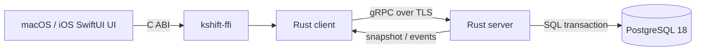

# Kshift

结论：Kshift 是只在内网运行的 macOS/iOS 共享任务工作台。

## 当前状态

- 阶段：R2 共享 SwiftUI 基座已实现。
- Spec 版本：`0.1`。
- 实现状态：共享 UI 基座可构建；P0 日计划 MVP 尚未实现。
- 权威入口：[Kshift Spec v0.1](docs/spec/kshift-spec-v0.1.md)。
- 讨论来源：[Discussion #1](https://github.com/wyz541/Kshift/discussions/1)。
- 总任务：[Issue #2](https://github.com/wyz541/Kshift/issues/2)。
- 下一个任务：[Issue #7](https://github.com/wyz541/Kshift/issues/7)。

## 首版边界

| 项目 | 首版决策 |
| --- | --- |
| 平台 | macOS 26.0+、iOS 26.0+ |
| UI | 一套共享 SwiftUI；平台能力使用 adapter |
| 视觉 | Apple 原生 Liquid Glass |
| 业务逻辑 | Rust 唯一 owner |
| 服务 | Rust server、gRPC、PostgreSQL 18 |
| 部署 | 内网 macOS 开发机 |
| 同步 | revisioned snapshot 和 transactional outbox |
| 发布 | GitHub 多平台 Release |

## 系统边界

下图展示首版的唯一定位链。UI 不绕过 Rust client。



## 共享 SwiftUI 基座

| 路径 | 职责 |
| --- | --- |
| `Sources/KshiftPresentation` | 业务快照、typed command 和 presentation mapping |
| `Sources/KshiftFFI` | Swift FFI 边界和可替换的内存实现 |
| `Sources/KshiftUI` | 共享 SwiftUI 页面、组件、语义色和 Liquid Glass 入口 |
| `Sources/KshiftAppKitAdapter` | macOS 系统能力和 `NSViewRepresentable` |
| `Sources/KshiftUIKitAdapter` | iOS 系统能力和 `UIViewControllerRepresentable` |
| `Apps/KshiftMacOS` | macOS 最小启动入口 |
| `Apps/KshiftIOS` | iOS 最小启动入口 |
| `Kshift.xcodeproj` | 两个 app target 和共享 package 引用 |

当前边界：

- macOS 和 iOS 组合同一个 `KshiftDayPlanFeatureView`。
- AppKit 和 UIKit 只处理系统能力，不承载产品页面。
- 共享代码不使用 HTTP、PostgreSQL 或 protobuf 类型。
- `#if os(...)` 只出现在 app entry。
- `InMemoryKshiftFFIBoundary` 只提供界面基座样例。Issue #5 接入正式 `kshift-ffi`。
- 当前构建使用 Xcode 27.2 SDK。部署目标为 macOS 26.0 和 iOS 26.0。

## 构建

1. 检查共享边界。

   ```sh
   ./Scripts/check-platform-boundaries.sh
   ```

2. 运行共享测试。

   ```sh
   swift test
   ```

3. 构建 macOS app。

   ```sh
   xcodebuild -project Kshift.xcodeproj -scheme Kshift-macOS -destination 'platform=macOS' CODE_SIGNING_ALLOWED=NO build
   ```

4. 构建 iOS app。

   ```sh
   xcodebuild -project Kshift.xcodeproj -scheme Kshift-iOS -destination 'generic/platform=iOS Simulator' CODE_SIGNING_ALLOWED=NO build
   ```

## 文档入口

| 内容 | 入口 |
| --- | --- |
| 产品、技术、UI 和验收规范 | [Spec v0.1](docs/spec/kshift-spec-v0.1.md) |
| Discussion 到 Spec 的映射 | [Traceability](docs/spec/traceability.md) |
| 关键决策状态 | [Decision Register](docs/decisions/decision-register.md) |
| 未决项、owner 和截止日期 | [Open Questions](docs/decisions/open-questions.md) |
| 架构决策记录 | [ADR Index](docs/adr/README.md) |
| 协议和 Release 合同 | [Contracts](docs/contracts/README.md) |
| 贡献与评审流程 | [CONTRIBUTING](CONTRIBUTING.md) |

## 当前限制

- 身份认证方式尚未确认。
- macOS 和 iOS 分发方式尚未确认。
- Release 仓库、通道和审批人尚未确认。
- 业务成功指标尚未确认。
- 真实 `kshift-ffi` 和产品服务尚未接入。
- P0 日计划流程、无障碍证据和性能读数尚未完成。

## 来源

- [Discussion #1：Kshift 内网 macOS/iOS Spec、路线与 Release](https://github.com/wyz541/Kshift/discussions/1)
- [Issue #2：Kshift v1 总目标](https://github.com/wyz541/Kshift/issues/2)
- [Apple HIG：Materials](https://developer.apple.com/design/human-interface-guidelines/materials)
