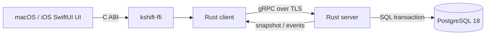

# Kshift

结论：Kshift 是只在内网运行的 macOS/iOS 共享任务工作台。

## 当前状态

- 阶段：R0 Spec 评审。
- Spec 版本：`0.1`。
- 实现状态：尚未开始。
- 权威入口：[Kshift Spec v0.1](docs/spec/kshift-spec-v0.1.md)。
- 讨论来源：[Discussion #1](https://github.com/wyz541/Kshift/discussions/1)。
- 总任务：[Issue #2](https://github.com/wyz541/Kshift/issues/2)。
- 当前任务：[Issue #3](https://github.com/wyz541/Kshift/issues/3)。

## 首版边界

| 项目 | 首版决策 |
| --- | --- |
| 平台 | macOS 26.0+、iOS 26.0+ |
| UI | 一套共享 SwiftUI；平台能力使用 adapter |
| 视觉 | Apple 原生 Liquid Glass |
| 业务逻辑 | Rust 唯一 owner |
| 服务 | Rust server、gRPC、PostgreSQL 18 |
| 部署 | 内网 macOS 开发机 |
| 同步 | revisioned snapshot 和 transactional outbox |
| 发布 | GitHub 多平台 Release |

## 系统边界

下图展示首版的唯一定位链。UI 不绕过 Rust client。

## 文档入口

| 内容 | 入口 |
| --- | --- |
| 产品、技术、UI 和验收规范 | [Spec v0.1](docs/spec/kshift-spec-v0.1.md) |
| Discussion 到 Spec 的映射 | [Traceability](docs/spec/traceability.md) |
| 关键决策状态 | [Decision Register](docs/decisions/decision-register.md) |
| 未决项、owner 和截止日期 | [Open Questions](docs/decisions/open-questions.md) |
| 架构决策记录 | [ADR Index](docs/adr/README.md) |
| 协议和 Release 合同 | [Contracts](docs/contracts/README.md) |
| 贡献与评审流程 | [CONTRIBUTING](CONTRIBUTING.md) |

## 当前限制

- 身份认证方式尚未确认。
- macOS 和 iOS 分发方式尚未确认。
- Release 仓库、通道和审批人尚未确认。
- 业务成功指标尚未确认。
- 仓库当前只有 Spec 和合同。没有运行中的产品服务。

## 来源

- [Discussion #1：Kshift 内网 macOS/iOS Spec、路线与 Release](https://github.com/wyz541/Kshift/discussions/1)
- [Issue #2：Kshift v1 总目标](https://github.com/wyz541/Kshift/issues/2)
- [Apple HIG：Materials](https://developer.apple.com/design/human-interface-guidelines/materials)
