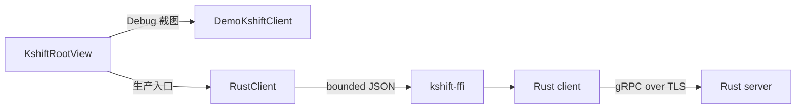

# R2 MVP 证据

结论：#7 的共享 SwiftUI 日计划 MVP 已在 macOS 和 iOS 验证。共享 P0 E2E 覆盖两个项目时区、视图、核心操作、历史和冲突语义。

## 客户端路径

下图展示两条客户端路径。Debug 截图使用本地演示数据。生产入口使用 `RustClient`。

`DemoKshiftClient` 只用于 Debug、预览和 UI 证据。Release 入口使用 `RustClient`。`RustClient` 读取 `KSHIFT_ENDPOINT`、`KSHIFT_CA_PATH` 或 `KSHIFT_CA_PEM`、`KSHIFT_TOKEN`。

`KshiftRootView` 是唯一日计划 UI。并行原型已归档在 Git 提交 `84a8d1d`。决策见 [ADR-0009](adr/0009-single-day-plan-ui.md)。

## 时区语义

| 日期或时间 | 使用的时区 | 验证 |
| --- | --- | --- |
| 今天按钮、日期选择、日历分桶、每日任务数 | 项目 IANA 时区 | 单元测试、macOS/iOS live P0 |
| 日历中的“今天”标记 | 项目 IANA 时区 | iOS live UI |
| 任务绝对时间戳 | 用户时区 | 单元测试 |
| 无效用户时区回退 | 项目 IANA 时区 | 单元测试 |

`KSHIFT_USER_TIME_ZONE` 和 `KSHIFT_NOW` 只用于可控环境。生产环境默认读取用户系统时区。

## 功能映射

| 验收项 | 实现 | 自动证据 | 状态 |
| --- | --- | --- | --- |
| 项目切换与隔离 | 单一异步 `selectProject` 路径 | `testSelectProjectLoadsSnapshotWhenSelectionWasAlreadyUpdated`、live P0 | 已验证 |
| 人员与日期看板 | `BoardView` 按负责人分组 | live P0 | 已验证 |
| 新增任务 | `TaskEditorView` 发送 typed command | live P0、iOS `testBothProjectTimeZonesAndLiveUIWriteE2E` | 已验证 |
| 编辑任务 | 版本化 `UpdateTaskCommand` | live P0 | 已验证 |
| 删除任务 | 确认对话框和 typed command | live P0 | 已验证 |
| 拖拽 | `draggable` 和 `dropDestination` | live P0 检查目标负责人和项目日期 | 已验证 |
| 状态、优先级、人员、日期 | typed enum 和模型字段 | live P0、`ModelEncodingTests` | 已验证 |
| 日历、今天按钮、每日任务数 | 项目时区驱动的 `CalendarView` 和 `AppModel` | `testProjectTimeZoneControlsTodayDateSelectionAndDailyCounts`、live P0、iOS live UI | 已验证 |
| 表格 | `TaskTableView` | live P0 | 已验证 |
| 搜索、筛选、排序 | `AppModel.filteredTasks` | live P0、`testSearchAndFiltersReduceDailyTasks` | 已验证 |
| 批量处理 | `BatchUpdateTasksCommand` | live P0、service integration | 已验证 |
| 并发冲突 | revision 和 task version | live P0、Rust conflict tests、`testConflictIsExplicitAndDoesNotReplaceSnapshot` | 已验证 |
| 历史 | task history 和 project audit UI | live P0、iOS live UI、service integration | 已验证 |
| macOS P0 E2E | 共享 `KshiftP0E2EProbe` | `testMacOSLiveP0Scenario` | 已验证 |
| iOS P0 E2E | 同一 `KshiftP0E2EProbe` | `testIOSLiveP0Scenario` | 已验证 |
| Liquid Glass | 原生 Glass API | `scripts/verify.sh` 结构检查 | 已验证 |
| 唯一日计划 UI | `KshiftRootView` 和 `AppModel` | app entry tests、`scripts/check-platform-boundaries.sh` | 已验证 |
| FFI-only boundary | UI 只调用 `KshiftClientProtocol` | `scripts/check-platform-boundaries.sh` | 已验证 |

## 无障碍

| 检查 | 状态 | 证据 |
| --- | --- | --- |
| 触控目标 | 通过 | iOS `testCoreActionsMeetMinimumTouchTargets` |
| 完整无障碍审计 | 通过，2 项误报豁免 | iOS `testAccessibilityAudit` |
| 系统大号文字 | 核心操作和标题/日期布局通过 | iOS `testAccessibilityTextSizeKeepsCoreActionsAvailable` |
| 亮色和深色 | 已截图 | `docs/evidence/accessibility` |
| Increase Contrast | 已截图 | `docs/evidence/accessibility/ios-increase-contrast.png` |
| Reduce Transparency | 已截图，使用环境覆盖 | 系统设置入口不在 `simctl ui` 中 |
| Reduce Motion | 已截图 | 截图不证明全部动画行为 |

## 性能

| 场景 | 设备 | 平均值 | RSD | 样本 |
| --- | --- | ---: | ---: | ---: |
| 看板左右滚动 | iPhone 18 Pro，iOS 27.0 模拟器 | 2.952 s | 0.779% | 3 |
| 拖拽 | iPhone 18 Pro，iOS 27.0 模拟器 | 1.674 s | 0% | 1 |
| Sheet 打开和关闭 | iPhone 18 Pro，iOS 27.0 模拟器 | 7.357 s | 0.524% | 3 |

这些数值来自 `XCTClockMetric`。数值是 XCUITest automation clock，不是帧耗时，也不是 Instruments trace。真实服务端 E2E 见 [Live server evidence](evidence/live-server.md)。性能详见 [Performance](evidence/performance.md)。

## 冲突语义

| 情况 | adapter 返回 | 写入 |
| --- | --- | --- |
| 项目 revision 过期 | `revision_conflict` | 拒绝 |
| 任务 version 过期 | `version_conflict` | 拒绝 |
| 批量中一个任务失败 | `version_conflict` | 整个事务回滚，不写入部分结果 |
| 同一 command ID 重试 | Rust client 幂等缓存 | 不重复写入 |

## Liquid Glass 预算

| 区域 | 策略 |
| --- | --- |
| 导航、侧栏、工具栏、Sheet | 使用系统组件 |
| 看板交互卡片 | 原生 `Glass.regular` |
| 同列卡片 | 一个 `GlassEffectContainer` |
| 每列玻璃卡片 | 最多 6 个 |
| 卡片文字 | 稳定内容底板 |
| 表格、长文本、日历网格 | 清晰内容底板 |
| 冲突提示和批量栏 | 一个受控 `GlassEffectContainer` |
| Reduce Transparency | 卡片和列底改用不透明背景 |

## 未完成

| 项目 | 原因 |
| --- | --- |
| Instruments frame trace | 当前性能读数来自 XCUITest automation clock |
