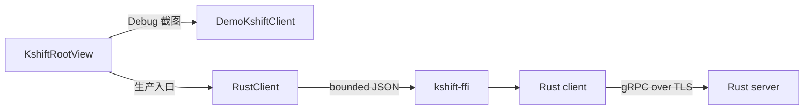

# R2 MVP 证据

结论：#7 的共享 SwiftUI 日计划 MVP 已可构建和运行。生产路径已适配 #15 的 Rust client C ABI；UI 到真实 gRPC/PostgreSQL server 的端到端流程仍未验证。

## 客户端路径

下图展示两条客户端路径。Debug 截图使用本地演示数据。生产入口使用 `RustClient`。

`DemoKshiftClient` 只用于 Debug、预览和 UI 证据。Release 入口使用 `RustClient`。`RustClient` 读取 `KSHIFT_ENDPOINT`、`KSHIFT_CA_PATH` 或 `KSHIFT_CA_PEM`、`KSHIFT_TOKEN`。

## 功能映射

| 验收项 | 实现 | 自动证据 | 状态 |
| --- | --- | --- | --- |
| 项目切换 | `SidebarView` 和紧凑项目菜单 | `testProjectSwitchKeepsDataIsolated` | 已验证 |
| 人员与日期看板 | `BoardView` 按负责人分组 | `testBootstrapLoadsFirstProjectAndDailyBoard` | 已验证 |
| 新增任务 | `TaskEditorView` 发送 typed command | iOS `testCreateTaskThroughSharedPlanner` | 已验证，使用演示客户端 |
| 编辑任务 | 版本化 `UpdateTaskCommand` | `testCreateCommandUsesCurrentRevision` | 已验证，使用假客户端 |
| 删除任务 | 确认对话框和 typed command | `AppModelTests` | 已验证，使用假客户端 |
| 拖拽 | `draggable` 和 `dropDestination` | iOS `testDragTaskPerformance` | 已验证，使用演示客户端 |
| 状态、优先级、人员、日期 | typed enum 和模型字段 | `ModelEncodingTests` | 已验证 |
| 日历 | `CalendarView` | iOS build | 已构建 |
| 表格 | `TaskTableView` | iOS build | 已构建 |
| 搜索、筛选、排序 | `AppModel.filteredTasks` | `testSearchAndFiltersReduceDailyTasks` | 已验证 |
| 批量处理 | `SetTasksStatusCommand` | UI 和演示客户端 | 已验证，生产适配为顺序更新 |
| 并发冲突 | revision 和 task version | Rust conflict tests、`testConflictIsExplicitAndDoesNotReplaceSnapshot` | 已验证到 adapter 和假客户端 |
| 历史 | task history 和 project audit UI | 尚无 live snapshot 字段映射 | 未完成 live 验证 |
| Liquid Glass | 原生 Glass API | `scripts/verify.sh` 结构检查 | 已验证 |
| 单 UI 实现 | `Sources/KshiftUI` 无平台条件分支 | `scripts/verify.sh`、adapter tests | 已验证 |
| FFI-only boundary | UI 只调用 `KshiftClientProtocol` | `scripts/check-platform-boundaries.sh` | 已验证 |

## 无障碍

| 检查 | 状态 | 证据 |
| --- | --- | --- |
| 触控目标 | 通过 | iOS `testCoreActionsMeetMinimumTouchTargets` |
| 系统大号文字 | 通过 | iOS `testAccessibilityTextSizeKeepsCoreActionsAvailable` |
| 亮色和深色 | 已截图 | `docs/evidence/accessibility` |
| Increase Contrast | 已截图 | `docs/evidence/accessibility/ios-increase-contrast.png` |
| Reduce Transparency | 已截图，使用环境覆盖 | 系统设置入口不在 `simctl ui` 中 |
| Reduce Motion | 已截图 | 截图不证明全部动画行为 |
| VoiceOver | 待检查 | 需要人工 Accessibility Inspector |
| macOS 键盘导航 | 待检查 | macOS UI test runner 未建立连接 |
| 真机检查 | 待检查 | 当前证据来自模拟器 |

## 性能

| 场景 | 设备 | 平均值 | RSD | 样本 |
| --- | --- | ---: | ---: | ---: |
| 看板左右滚动 | iPhone 18 Pro，iOS 27.0 模拟器 | 2.937 s | 0.458% | 3 |
| 拖拽 | iPhone 18 Pro，iOS 27.0 模拟器 | 1.676 s | 0% | 1 |
| Sheet 打开和关闭 | iPhone 18 Pro，iOS 27.0 模拟器 | 7.436 s | 0.187% | 3 |
| macOS 窗口缩放 | macOS | 未采集 | 未采集 | 0 |

这些数值来自 `XCTClockMetric`。数值是 XCUITest automation clock，不是帧耗时，也不是 Instruments trace。详见 [Performance](evidence/performance.md)。

## 冲突语义

| 情况 | adapter 返回 | 写入 |
| --- | --- | --- |
| 项目 revision 过期 | `revision_conflict` | 拒绝 |
| 任务 version 过期 | `version_conflict` | 拒绝 |
| 批量中一个任务失败 | 返回失败和已完成项目快照 | 生产适配为顺序更新，不是原子事务 |
| 同一 command ID 重试 | Rust client 幂等缓存 | 不重复写入 |

## Liquid Glass 预算

| 区域 | 策略 |
| --- | --- |
| 导航、侧栏、工具栏、Sheet | 使用系统组件 |
| 看板交互卡片 | 原生 `Glass.regular` |
| 同列卡片 | 一个 `GlassEffectContainer` |
| 每列玻璃卡片 | 最多 6 个 |
| 卡片文字 | 稳定内容底板 |
| 表格、长文本、日历网格 | 清晰内容底板 |
| 冲突提示和批量栏 | 一个受控 `GlassEffectContainer` |
| Reduce Transparency | 卡片和列底改用不透明背景 |

## 未完成

| 项目 | 原因 |
| --- | --- |
| UI 到真实 gRPC/PostgreSQL 的 E2E | 尚未配置登录和 server fixture |
| 多人并发冲突的真机验证 | 需要两个客户端和共享 server |
| 批量操作原子性 | #15 C ABI 当前只暴露单条 typed command |
| task history 和 project audit 的 live 映射 | 当前 snapshot JSON 不含所需历史字段 |
| VoiceOver | 需要人工检查 |
| macOS 键盘导航 | macOS UI test runner 未建立连接 |
| macOS 窗口缩放性能 | 没有有效读数 |
| 真机环境 | 当前只验证 Simulator |
