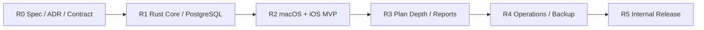
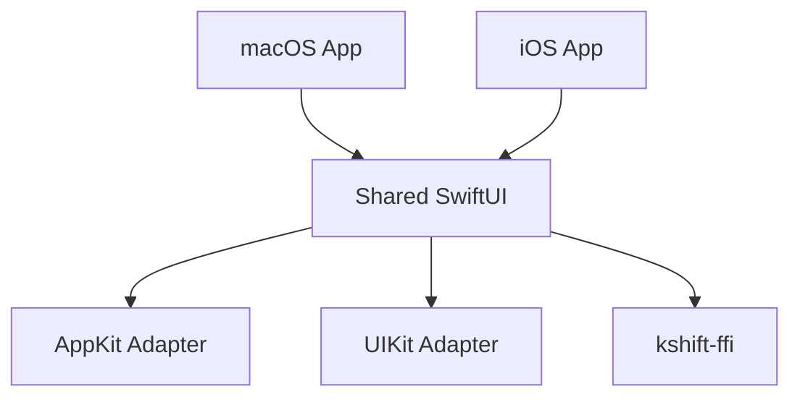
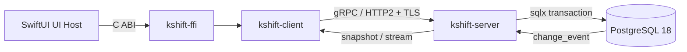
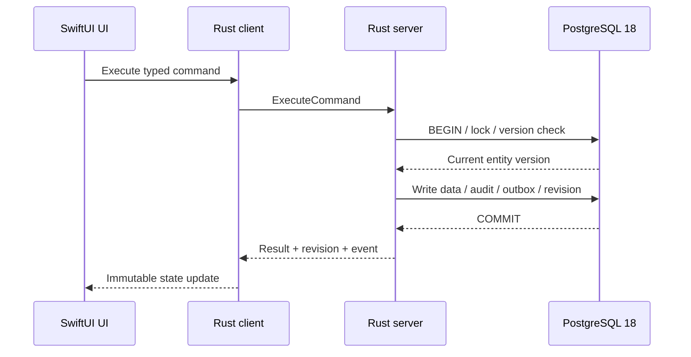
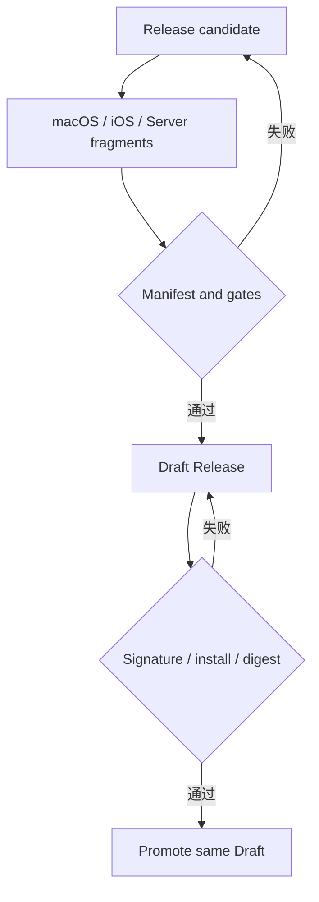

# Kshift Spec v0.1

> 结论：Kshift v1 是只在内网运行的 macOS/iOS 共享任务工作台。Rust 是业务权威，SwiftUI 是共享 UI，PostgreSQL 18 是共享持久化层。

## 0. 文档控制

| 项目 | 内容 |
| --- | --- |
| 状态 | `active` |
| 版本 | `0.1` |
| Owner | `@wyz541` |
| 正式评审 | [R0 Spec Review](../reviews/2026-11-13-r0-spec-review.md) |
| 生效日期 | `2026-11-13` |
| 下一次复核 | `2026-12-11` |
| 首版平台 | macOS 26.0+、iOS 26.0+ |
| 实现起点 | [Issue #2](https://github.com/wyz541/Kshift/issues/2) |
| 讨论来源 | [Discussion #1](https://github.com/wyz541/Kshift/discussions/1) |

本文使用三个规范词。

| 规范词 | 含义 |
| --- | --- |
| 必须 | 验收前必须满足 |
| 禁止 | 不得实施；需要例外时先修改 Spec |
| 可以 | 允许实施；不影响必需验收 |

决策状态使用三个值。

| 状态 | 含义 |
| --- | --- |
| `confirmed` | 已进入 v0.1 基线 |
| `pending` | 尚未决定；实现 PR 不得自行选择 |
| `rejected` | 明确拒绝或排除在首版外 |

## 1. 问题与愿景

Kshift 要解决小团队的任务协作问题。团队需要按项目、人员和自然日期查看同一组任务。

当前问题有三项。

1. 任务分散在表格、聊天和个人清单中。
2. 多人修改容易互相覆盖。
3. macOS 和 iOS 很难保持同一业务语义。

Kshift v1 的目标如下。

- 提供共享任务数据库。
- 提供多人并发编辑。
- 提供 macOS 和 iOS 的共享界面。
- 提供可备份、可恢复、可内网发布的运行方式。

Kshift 对齐 `wooduan-taskboard` 的可观察用户能力。Kshift 不复制参考产品的源码或技术栈。

## 2. 用户与关键场景

| 用户 | 主要目标 | 首版权限 |
| --- | --- | --- |
| Viewer | 查看计划、搜索任务和导出只读结果 | 只读 |
| Editor | 创建、编辑、移动和删除任务 | 项目读写 |
| Admin | 管理成员、数据库运维和备份恢复 | 全部管理权限 |

角色实施属于 R4。R2 可以先用受控测试身份。服务端必须保留最终鉴权边界。

### 2.1 P0 用户场景

| ID | 场景 | 结果 |
| --- | --- | --- |
| `SCN-001` | 用户切换到授权项目 | 只看到该项目数据 |
| `SCN-002` | 用户按人员和自然日期查看看板 | 任务出现在正确列 |
| `SCN-003` | 用户新建或编辑任务 | 服务端提交新 revision |
| `SCN-004` | 用户拖拽任务到其他人员或日期 | 任务和事件原子更新 |
| `SCN-005` | 两名用户编辑同一任务 | 过期写入被拒绝 |
| `SCN-006` | 用户按状态、优先级或负责人筛选 | 结果保持项目隔离 |
| `SCN-007` | 用户断网后继续查看内存快照 | 写入禁用并提示重连 |
| `SCN-008` | Admin 创建备份并恢复测试库 | 数据通过不变量检查 |

## 3. 范围与非目标

### 3.1 首版范围

- macOS 和 iOS 客户端。
- Rust server 和 Rust client。
- PostgreSQL 18 共享数据库。
- 项目、成员、任务、状态、优先级、负责人和日期。
- 人员与日期看板、日历、表格和基础统计。
- 搜索、筛选、排序和批量处理。
- 多人并发编辑、冲突提示和 revision 同步。
- 子任务、依赖、甘特、历史、附件和报告。
- Viewer、Editor 和 Admin 角色。
- 受限数据库管理。
- 备份、恢复、服务和日志管理。
- GitHub 内网 Release。

### 3.2 非目标

以下内容状态为 `rejected`。

- Web 产品。
- Windows 客户端。
- Android 客户端。
- 外部平台导入。
- 公网部署。
- 离线写入和离线写队列。
- 客户端直接连接 PostgreSQL。
- SwiftUI UI 直接调用 HTTP。
- 平台各自复制产品页面和状态机。
- 自绘玻璃材质。
- 静默覆盖并发写入。
- 无界队列和无限重试。

新增平台或新增同步模型时，必须先修改 Spec 并增加 ADR。

## 4. 产品路线

下图展示首版交付顺序。每个阶段只在上游门禁通过后启动。

| 阶段 | 产品结果 | 退出条件 | Issue |
| --- | --- | --- | --- |
| R0 | 可评审的 Spec、ADR 和合同 | 本文评审通过 | [#3](https://github.com/wyz541/Kshift/issues/3) |
| R1 | 可运行的共享服务核心 | 并发、迁移和合同测试通过 | [#4](https://github.com/wyz541/Kshift/issues/4)、[#5](https://github.com/wyz541/Kshift/issues/5) |
| R2 | macOS/iOS 日计划 MVP | P0 E2E、复用和 Liquid Glass 门禁通过 | [#6](https://github.com/wyz541/Kshift/issues/6)、[#7](https://github.com/wyz541/Kshift/issues/7) |
| R3 | 计划深度与复盘 | 验收数据集通过 | [#8](https://github.com/wyz541/Kshift/issues/8) |
| R4 | 可运营的内网产品 | 权限、备份和恢复演练通过 | [#9](https://github.com/wyz541/Kshift/issues/9) |
| R5 | 可发布的内网产品 | 安装、升级、签名和回滚证据通过 | [#9](https://github.com/wyz541/Kshift/issues/9) |

## 5. 功能规范

### 5.1 项目与成员

- `FR-PRJ-001`：用户必须只看到已授权项目。
- `FR-PRJ-002`：项目切换必须清除旧项目的可见任务。
- `FR-PRJ-003`：服务端必须执行项目级授权。
- `FR-PRJ-004`：身份来源状态为 `pending`。客户端提交的角色不得作为授权依据。
- `FR-PRJ-005`：每个项目必须保存一个 IANA `time_zone`。
- `FR-PRJ-006`：项目时区决定自然日期。用户时区只决定绝对时间戳的显示。

### 5.2 任务

- `FR-TSK-001`：任务必须包含项目、标题、状态、优先级、负责人和自然日期。
- `FR-TSK-002`：任务更新必须携带实体版本前置条件。
- `FR-TSK-003`：任务删除必须携带实体版本前置条件。
- `FR-TSK-004`：看板拖拽必须作为 typed command 提交。
- `FR-TSK-005`：批量处理必须原子提交；任一实体版本过期时整批拒绝。
- `FR-TSK-006`：R3 的子任务、依赖、附件和 Markdown 描述必须使用 v1 合同扩展点。
- `FR-TSK-007`：任务负责人是集合。集合包含 0 至 20 个唯一用户 ID。
- `FR-TSK-008`：负责人必须是当前项目的活跃成员。空集合表示未分配。
- `FR-TSK-009`：负责人写入替换完整集合。列表顺序不表示主负责人或排序优先级。
- `FR-TSK-010`：服务端输出负责人时按用户 ID 升序排列，保证相同 revision 的 snapshot 稳定。

### 5.3 视图与查询

- `FR-VIEW-001`：R2 必须提供人员与自然日期看板。
- `FR-VIEW-002`：R2 必须提供日历和表格视图。
- `FR-VIEW-003`：搜索、筛选和排序必须在当前项目内执行。
- `FR-VIEW-004`：基础统计必须基于同一 snapshot revision。
- `FR-VIEW-005`：报告和导出必须记录使用的项目 revision。
- `FR-VIEW-006`：人员看板、日历和自然日期筛选必须使用项目时区。
- `FR-VIEW-007`：多负责人任务必须出现在每个负责人的人员列。筛选匹配任一负责人。
- `FR-VIEW-008`：把任务拖到人员列时，负责人集合替换为目标人员。拖到未分配列时，负责人集合清空。

### 5.4 并发与冲突

- `FR-CON-001`：服务端必须在事务内检查 revision 和实体版本。
- `FR-CON-002`：过期任务写入必须返回冲突。
- `FR-CON-003`：冲突结果必须包含当前项目 revision、实体 ID 和当前实体版本。
- `FR-CON-004`：客户端禁止自动合并任务内容。
- `FR-CON-005`：客户端禁止自动覆盖冲突。
- `FR-CON-006`：UI 必须允许用户刷新或重新提交。
- `FR-CON-007`：成功命令必须保持幂等。相同 `(client_id, command_id)` 返回同一结果。

### 5.5 历史与审计

- `FR-HIS-001`：每次成功写入必须生成审计记录。
- `FR-HIS-002`：审计记录必须包含 actor、command、project、entity 和时间。
- `FR-HIS-003`：R3 历史回退必须生成新的审计记录。
- `FR-HIS-004`：日志禁止包含 token、数据库密码、完整敏感请求体或附件内容。

### 5.6 备份与管理

- `FR-OPS-001`：Admin 必须可以查看备份状态。
- `FR-OPS-002`：Admin 必须可以执行恢复演练。
- `FR-OPS-003`：受限数据库管理必须使用只读查询，或使用受审计的受控操作。
- `FR-OPS-004`：服务必须支持 `launchd` 启动、健康检查和日志轮转。
- `FR-OPS-005`：迁移前必须创建备份。

## 6. 体验与 UI

### 6.1 平台矩阵

| 项目 | 决策 |
| --- | --- |
| 最低系统 | macOS 26.0、iOS 26.0 |
| 共享 UI | SwiftUI feature slices、components、styles、presentation mapping |
| macOS 适配 | AppKit adapter |
| iOS 适配 | UIKit adapter；只处理系统集成 |
| 业务状态 | Rust client 提供的 immutable snapshot 或 event |
| 视觉核心 | Apple 原生 Liquid Glass |

### 6.2 复用门禁

下图展示共享 UI 与平台 adapter 的边界。

- `UI-REU-001`：macOS 和 iOS 的 P0 页面必须来自同一 SwiftUI 实现。
- `UI-REU-002`：页面、状态机、校验、数据映射和导航不得复制到平台 target。
- `UI-REU-003`：AppKit 只处理 macOS 特有能力，例如窗口、菜单、键盘命令、拖放和系统面板。
- `UI-REU-004`：UIKit 只包装 UIKit-only controller 或 iOS 特有能力。
- `UI-REU-005`：SwiftUI 或系统组件已覆盖需求时，禁止新增 AppKit 或 UIKit 实现。
- `UI-REU-006`：`#if os(...)` 只允许出现在 app entry、capability adapter 和 platform style resolver。
- `UI-REU-007`：两端可以自适应窗口尺寸。行为、验收语义和业务状态必须一致。

### 6.3 Liquid Glass 边界

“应用尽用”按交互语义执行。

| 场景 | 必须使用 | 禁止行为 |
| --- | --- | --- |
| 窗口、侧栏、导航、标签栏、工具栏 | SwiftUI 系统组件 | 自绘替代系统材质 |
| Sheet、Popover、菜单 | 系统原生 Liquid Glass | 固定透明度和高光仿制 |
| 主要操作按钮 | `.buttonStyle(.glassProminent)` | 自绘模糊背景 |
| 次要操作和浮动操作 | `.buttonStyle(.glass)` 或原生 `.glassEffect(...)` | 每控件单独创建容器 |
| 可拖拽、可选择、可执行命令的任务卡片 | `Glass.regular` 外表面 | 玻璃直接承载低对比文字 |
| 同组相邻玻璃卡片 | 共用一个 `GlassEffectContainer` | 每卡片一个 container |
| 纯展示卡片 | 标准材质或清晰内容底板 | 用玻璃作为唯一可读表面 |
| 正文、密集表格、长文本编辑 | 清晰内容底板 | 低对比玻璃正文 |
| AppKit 专属区域 | `NSGlassEffectView` 和 SwiftUI wrapper | 另写一套 AppKit 产品 UI |

- `UI-GLS-001`：只使用 Apple 原生材质和 API。
- `UI-GLS-002`：禁止自绘模糊、折射、噪点、渐变或高光来模拟玻璃。
- `UI-GLS-003`：交互卡片使用 `Glass.regular`。文字和控件必须位于对比稳定的内容底板。
- `UI-GLS-004`：纯展示和密集内容默认使用标准材质。玻璃可以只作为外层容器。
- `UI-GLS-005`：同屏玻璃 effect 和 container 必须有性能上限。
- `UI-GLS-006`：超过实测预算时，优先保留导航和当前操作卡片。
- `UI-GLS-007`：使用系统语义色和 tint。禁止用玻璃透明度承载状态含义。

### 6.4 无障碍与性能

- `UI-A11Y-001`：必须支持 Reduce Transparency。
- `UI-A11Y-002`：必须支持 Increase Contrast。
- `UI-A11Y-003`：必须支持 Reduce Motion。
- `UI-A11Y-004`：必须支持 Dark Mode 和系统文字大小。
- `UI-A11Y-005`：无障碍验收必须使用可重复的自动 UI 测试。
- `UI-A11Y-006`：iOS 必须通过自动无障碍审计、触控目标和动态文字测试。
- `UI-PERF-001`：iOS 滚动、拖拽和 Sheet 切换必须有 XCUITest 性能读数。
- `UI-PERF-002`：性能读数必须记录设备、系统、测试名称和指标。

## 7. 架构

### 7.1 调用链

下图是首版唯一允许的调用链。

- `ARC-001`：UI host 只调用 `kshift-ffi`。
- `ARC-002`：UI host 禁止直接调用 HTTP。
- `ARC-003`：UI host 禁止连接 PostgreSQL。
- `ARC-004`：PostgreSQL 凭据只存在服务端配置。
- `ARC-005`：Rust client 和 Rust server 共用 protobuf 合同。
- `ARC-006`：Rust 是业务规则、校验和持久化的唯一 owner。
- `ARC-007`：UI host 只拥有渲染、输入、焦点、无障碍、动画和临时 UI 状态。

### 7.2 Rust workspace

| Crate | 责任 | 禁止事项 |
| --- | --- | --- |
| `kshift-domain` | entity、command、业务不变量和纯 Rust 类型 | 不执行 I/O |
| `kshift-contract` | protobuf、error、snapshot、event 和 schema version | 不包含 UI 类型 |
| `kshift-client` | TLS、认证、deadline、取消、重试、revision 和缓存 | 不持有数据库凭据 |
| `kshift-server` | tonic service、鉴权、事务、审计和 outbox | 不包含 UI 状态 |
| `kshift-ffi` | C ABI、opaque handle、bounded buffer 和错误映射 | 不承载产品页面 |
| migrations | `sqlx` migration 和 digest | 不在 server 启动时自动执行 |

- `ARC-101`：crate 只依赖更内层模块。
- `ARC-102`：`unsafe` 只允许出现在 `kshift-ffi` 的 FFI 适配层。
- `ARC-103`：FFI 必须捕获 panic。panic 不得跨 C ABI。
- `ARC-104`：UI host 不接收 protobuf、tonic、sqlx 或数据库类型。

### 7.3 服务与数据库

| 项目 | 首版决策 |
| --- | --- |
| PostgreSQL | 18.x 最新可用 minor |
| 部署 | 与 Rust server 同机 |
| 数据库监听 | loopback 或 Unix socket |
| Server 监听 | 内网接口 |
| 连接池 | 最少 4、最多 20 |
| 获取连接超时 | 5 秒 |
| 默认隔离级别 | `READ COMMITTED` |
| 跨行不变量 | `SERIALIZABLE` |
| 绝对时间 | UTC `TIMESTAMPTZ` |
| 自然日期 | `DATE`，按项目 IANA 时区解释 |
| 用户时区 | 只用于显示绝对时间戳；缺失或非法时回退到项目时区 |
| 密码来源 | Keychain 或 `launchd` 受限环境变量 |

- `ARC-201`：数据库角色必须使用最小权限。
- `ARC-202`：`kshift_owner` 持有 schema 和 migration。
- `ARC-203`：`kshift_app` 只持有运行时 DML 权限。
- `ARC-204`：`kshift_backup` 只持有备份所需读取权限。
- `ARC-205`：运行角色不得是数据库超级用户。
- `ARC-206`：PostgreSQL 19 必须完成兼容性 ADR 后才能启用。

## 8. 同步与缓存

### 8.1 写入和事件流

下图展示一次成功写入的原子边界。命令结果、业务数据、审计和事件必须在同一事务提交。

- `SYNC-001`：每个成功写事务只生成一个 `change_event`。
- `SYNC-002`：业务数据、审计、命令结果、项目 revision 和 outbox 必须原子提交。
- `SYNC-003`：`change_event` 唯一约束必须为 `(project_id, revision)`。
- `SYNC-004`：事件 payload 必须使用版本化 protobuf。
- `SYNC-005`：`pg_notify` 只携带 `project_id`，并只用于唤醒分发。
- `SYNC-006`：Outbox 是事件事实源，`LISTEN/NOTIFY` 不是。
- `SYNC-007`：分发器必须按 revision 顺序读取事件。
- `SYNC-008`：`WatchProjectChanges(since_revision)` 必须回放缺失事件。
- `SYNC-009`：revision 不连续时必须返回 `ResetRequired`。
- `SYNC-010`：Outbox 保留 7 天。旧客户端必须重新获取 snapshot。
- `SYNC-011`：事件流每 15 秒发送 heartbeat。
- `SYNC-012`：重连使用带 jitter 的指数退避。初始 500 ms，上限 30 秒。
- `SYNC-013`：慢消费者超过有界 channel 时必须断开，并要求重新 snapshot。

### 8.2 客户端缓存

- `CACHE-001`：业务缓存只存在内存。
- `CACHE-002`：缓存最多保留 3 个最近项目。
- `CACHE-003`：normalized snapshot 总内存预算为 128 MiB。
- `CACHE-004`：超过预算时按 LRU 清理项目。
- `CACHE-005`：revision gap、schema mismatch 或授权变化时清除项目缓存。
- `CACHE-006`：首版禁止把任务业务数据写入磁盘。
- `CACHE-007`：首版禁止离线写队列。
- `CACHE-008`：断网时只读展示内存 snapshot，并禁用写入。
- `CACHE-009`：附件缓存可以使用磁盘 LRU，默认上限 256 MiB。
- `CACHE-010`：附件缓存以 SHA-256 为键，并开启平台文件保护。
- `CACHE-011`：退出账号、切换账号或失去权限时必须清除缓存。
- `CACHE-012`：认证 token 只存 macOS/iOS Keychain。

## 9. 安全与隐私

- `SEC-001`：服务只在内网提供。
- `SEC-002`：服务禁止直接暴露到公网。
- `SEC-003`：Server 证书 SAN 必须覆盖内网 DNS 名称和 loopback 名称。
- `SEC-004`：Stable gRPC 必须使用 TLS。禁止明文。
- `SEC-005`：客户端 token 必须放入 gRPC metadata。
- `SEC-006`：token 禁止进入 URL、日志、崩溃报告和 Release 资产。
- `SEC-007`：所有 RPC 必须有 deadline。
- `SEC-008`：客户端取消必须传递到服务端。
- `SEC-009`：Stable 禁止启用 gRPC reflection。
- `SEC-010`：健康检查继续启用。
- `SEC-011`：所有 unary message、event、snapshot 和附件必须有显式大小上限。具体值见 `CTR-008` 至 `CTR-011`。
- `SEC-012`：每个请求必须执行鉴权和项目级授权。
- `SEC-013`：Server 必须拒绝客户端提供的 role 或 permission。
- `SEC-014`：日志必须使用 request、project、client 和 command 标识。
- `SEC-015`：日志禁止记录 token、数据库密码、完整敏感请求体和附件内容。

## 10. 并发与容量

| 资源 | 首版目标 | 2 倍发布测试 |
| --- | ---: | ---: |
| 已连接客户端 | 50 | 100 |
| 同时编辑用户 | 20 | 40 |
| 并发写事务 | 8 | 16 |
| 并发事件流 | 32 | 64 |
| 并发 RPC | 100 | 200 |

- `CAP-001`：每个客户端最多 4 个并发 unary RPC。
- `CAP-002`：每个客户端最多 1 个事件流。
- `CAP-003`：Server 必须使用 semaphore 和 tower layer 限制连接、RPC、写事务和事件流。
- `CAP-004`：写事务超时为 10 秒。
- `CAP-005`：命令 deadline 必须大于写事务超时。
- `CAP-006`：超过容量时返回 `RESOURCE_EXHAUSTED`。
- `CAP-007`：队列必须有界。
- `CAP-008`：2 倍负载测试持续至少 30 分钟。
- `CAP-009`：测试必须记录 CPU、内存、连接数、事务等待、事件延迟和重连次数。
- `CAP-010`：发布门禁要求无崩溃、无内存无界增长、无丢事件和无静默覆盖。

## 11. 备份与恢复

- `BKP-001`：使用 `pg_dump --format=custom --no-owner --no-acl` 创建全量备份。
- `BKP-002`：每 4 小时创建一次备份。
- `BKP-003`：每次 migration 和 Stable Release 前必须创建备份。
- `BKP-004`：保留 42 个四小时备份。
- `BKP-005`：保留 12 个周备份。
- `BKP-006`：保留 12 个月备份。
- `BKP-007`：备份必须加密后复制到开发机之外。
- `BKP-008`：备份必须记录 PostgreSQL 版本、schema version、source commit、大小和 SHA-256。
- `BKP-009`：备份必须使用一致性快照。禁止复制正在写入的数据库目录。
- `BKP-010`：恢复必须进入临时数据库。
- `BKP-011`：恢复后必须检查 schema、外键、唯一性、引用和业务不变量。
- `BKP-012`：每月执行一次恢复演练。
- `BKP-013`：Stable Release 必须保留恢复证据。
- `BKP-014`：初始 RPO 和 RTO 均为 4 小时。
- `BKP-015`：备份 provider 状态为 `pending`。

## 12. 合同与兼容

| 合同 | 文件 | 版本 |
| --- | --- | --- |
| gRPC/protobuf | [`proto/kshift/v1/kshift.proto`](../../proto/kshift/v1/kshift.proto) | `kshift.v1` |
| Release manifest | [`schemas/release-manifest.schema.json`](../../schemas/release-manifest.schema.json) | `1` |
| Release fragment | [`schemas/release-fragment.schema.json`](../../schemas/release-fragment.schema.json) | `1` |

- `CTR-001`：protobuf package 必须是 `kshift.v1`。
- `CTR-002`：删除字段时，必须保留 field number 和 field name。
- `CTR-003`：改变字段语义或删除字段时，必须新增 package major version。
- `CTR-004`：所有 RPC 必须显式设置 deadline。
- `CTR-005`：协议大小上限固定为 request 1 MiB、response 和 snapshot 16 MiB、event 256 KiB、attachment 256 MiB。
- `CTR-006`：JSON Schema 只允许兼容扩展。
- `CTR-007`：Release fixture 必须通过 schema 校验。
- `CTR-008`：gRPC unary request 上限为 1 MiB。
- `CTR-009`：gRPC unary response 和 snapshot 上限为 16 MiB。
- `CTR-010`：单个 event 上限为 256 KiB。
- `CTR-011`：附件缓存单项上限为 256 MiB。

详细规则见 [Protocol Contract](../contracts/protocol-v0.1.md) 和 [Release Contract](../contracts/release-v0.1.md)。

## 13. 质量与发布

### 13.1 Rust 门禁

- `QA-RUST-001`：使用 `rust-toolchain.toml` 固定 toolchain。
- `QA-RUST-002`：提交并校验 `Cargo.lock`。
- `QA-RUST-003`：`cargo fmt --check` 通过。
- `QA-RUST-004`：`cargo clippy --all-targets --all-features -- -D warnings` 通过。
- `QA-RUST-005`：单元测试通过。
- `QA-RUST-006`：PostgreSQL 集成测试通过。
- `QA-RUST-007`：`buf lint` 通过。
- `QA-RUST-008`：buf breaking-change 检查通过。
- `QA-RUST-009`：`cargo deny check advisories bans licenses sources` 通过。
- `QA-RUST-010`：生成代码必须可重现。
- `QA-RUST-011`：Release 必须包含依赖 SBOM。

### 13.2 UI 门禁

- `QA-UI-001`：两端 P0 页面来自同一 shared SwiftUI 实现。
- `QA-UI-002`：两端 P0 行为和验收语义一致。
- `QA-UI-003`：AppKit 和 UIKit 只出现在 adapter 或系统集成边界。
- `QA-UI-004`：Liquid Glass 使用符合第 6.3 节。
- `QA-UI-005`：Reduce Transparency、Increase Contrast 和 Reduce Motion 检查通过。
- `QA-UI-006`：自动无障碍审计、触控目标和系统文字大小测试通过。
- `QA-UI-007`：iOS 滚动、拖拽和 Sheet 切换有 XCUITest 性能读数。

### 13.3 Release 门禁

下图展示单一写入者的发布流程。

- `REL-001`：一个版本只使用一个标签、一个 manifest 和一个 GitHub Release。
- `REL-002`：所有平台资产使用同一 source commit。
- `REL-003`：平台 workflow 只构建和验证，不写 Release。
- `REL-004`：只有一个 release orchestrator 可以写 Release。
- `REL-005`：Draft 验证通过后只提升同一个 Draft。
- `REL-006`：已发布标签和同名 Stable 资产禁止覆盖。
- `REL-007`：Stable 禁止包含 debug、ad-hoc 或 unsigned 资产。
- `REL-008`：Release manager 必须在受保护环境批准 Promote。
- `REL-009`：macOS 和 iOS 的最低系统版本必须写入 manifest 和 Release notes。
- `REL-010`：Release 必须包含 SHA-256、SBOM、provenance、attestation 和 gate 证据。

## 14. 项目治理

- `GOV-001`：实现 Issue 必须引用 Spec 章节、decision ID 和合同文件。
- `GOV-002`：Issue 不复制 Spec 的完整规则。
- `GOV-003`：改变已确认决策前必须先提交 ADR。
- `GOV-004`：未决项必须有 owner、截止日期和影响范围。
- `GOV-005`：未运行证据不得写成已验证。
- `GOV-006`：安全或私密事项使用 Security Advisory。
- `GOV-007`：大功能使用 Feature Issue 和原生 sub-issues。
- `GOV-008`：PR 必须包含验收证据和回滚说明。

决策状态见 [Decision Register](../decisions/decision-register.md)。未决项见 [Open Questions](../decisions/open-questions.md)。

## 15. 开放决策

以下决策状态为 `pending`。实现 PR 不得自行选择。

| ID | 问题 | Owner | 截止日期 | 影响 |
| --- | --- | --- | --- | --- |
| `OQ-001` | 内部身份使用本地账号、LDAP 还是 SSO | `@wyz541` | `2026-11-20` | 认证、Keychain 和成员管理 |
| `OQ-002` | macOS 使用 ad-hoc、Developer ID 或 notarization | `@wyz541` | `2026-11-20` | macOS 打包和 Stable 门禁 |
| `OQ-003` | iOS 使用 TestFlight、企业分发或签名 IPA | `@wyz541` | `2026-11-20` | iOS 安装和 Release 证据 |
| `OQ-004` | Release 放在当前仓库还是独立仓库 | `@wyz541` | `2026-11-20` | workflow 权限和资产 URL |
| `OQ-005` | 首版使用 Stable、Preview 还是 internal channel | `@wyz541` | `2026-11-20` | 版本和发布策略 |
| `OQ-006` | Release manager 使用单人还是双人批准 | `@wyz541` | `2026-11-20` | GitHub environment |
| `OQ-007` | Server 使用 tar 包、安装脚本或其他格式 | `@wyz541` | `2026-11-20` | 部署和升级 |
| `OQ-008` | 首版是否支持应用内更新 | `@wyz541` | `2026-11-27` | 更新检查和回滚 |
| `OQ-009` | 加密备份目标由谁提供 | `@wyz541` | `2026-11-27` | RPO、RTO 和恢复演练 |
| `OQ-010` | 产品成功指标的具体数值 | `@wyz541` | `2026-12-11` | 首轮试用和发布评审 |

`OQ-011` 已关闭。最终大小上限见第 9 节和第 12 节。决策记录见 `DEC-027`。

## 16. 正式评审结果

R0 正式评审已通过。评审记录见 [2026-11-13 R0 Spec Review](../reviews/2026-11-13-r0-spec-review.md)。

- [x] Spec v0.1 的章节可从 Discussion #1 追踪。
- [x] 每个关键决策有 `confirmed`、`pending` 或 `rejected` 状态。
- [x] 每个未决项有 owner、截止日期和影响范围。
- [x] macOS/iOS 复用边界和 Liquid Glass 门禁已写入。
- [x] protobuf 合同通过 `buf lint`。
- [x] Release JSON Schema 通过 meta-schema 校验。
- [x] 所有 Mermaid 图可解析。
- [x] 所有相对链接可打开。
- [x] 子 Issue 已增加 Spec 入口。
- [x] 评审人批准本文。

## 17. 来源

1. [Discussion #1：Kshift 内网 macOS/iOS Spec、路线与 Release](https://github.com/wyz541/Kshift/discussions/1)，访问日期 `2026-11-13`。
2. [Issue #2：Kshift v1 总目标](https://github.com/wyz541/Kshift/issues/2)，访问日期 `2026-11-13`。
3. [Issue #3：R0 Spec、ADR 和契约基线](https://github.com/wyz541/Kshift/issues/3)，访问日期 `2026-11-13`。
4. [Apple HIG：Materials](https://developer.apple.com/design/human-interface-guidelines/materials)，访问日期 `2026-11-13`。
5. [Applying Liquid Glass to custom views](https://developer.apple.com/documentation/swiftui/applying-liquid-glass-to-custom-views)，访问日期 `2026-11-13`。
6. [NSGlassEffectView](https://developer.apple.com/documentation/appkit/nsglasseffectview)，访问日期 `2026-11-13`。

## 18. 版本记录

| 版本 | 日期 | 变更 |
| --- | --- | --- |
| 0.1 | 2026-11-13 | 从 Discussion #1 形成首个版本。完成正式评审并进入 `active`。 |
