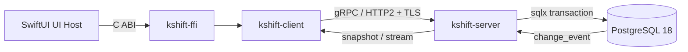
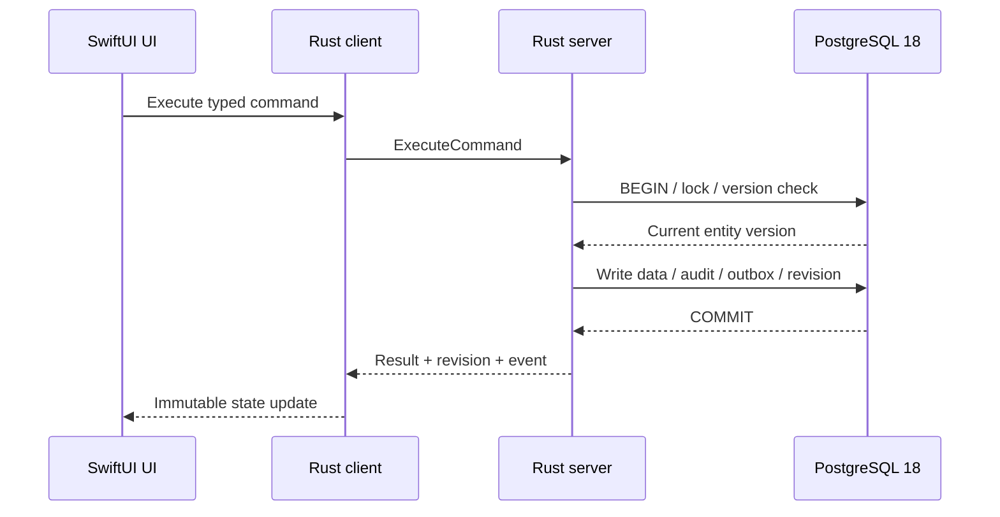

# KS-ARCH Kshift 架构与同步规范

> 结论：SwiftUI host 只通过 `kshift-ffi` 调用 Rust client。Rust client 和 server 使用 `kshift.v1` protobuf。同步使用 revisioned snapshot 和 transactional outbox。

## 1. 适用范围

本 Spec 约束运行时边界、Rust crate 责任、协议传输、数据库访问边界、快照、事件流、缓存和兼容性。

安全边界、部署和容量限制见 [KS-OPS](operations.md)。Release JSON Schema 兼容规则见 [KS-RELEASE](release.md)。

## 2. 调用链

下图是首版唯一允许的调用链。

- `ARC-001`：UI host 只调用 `kshift-ffi`。
- `ARC-002`：UI host 禁止直接调用 HTTP。
- `ARC-003`：UI host 禁止连接 PostgreSQL。
- `ARC-004`：PostgreSQL 凭据只存在服务端配置。
- `ARC-005`：Rust client 和 Rust server 共用 protobuf 合同。
- `ARC-006`：Rust 是业务规则、校验和持久化的唯一 owner。
- `ARC-007`：UI host 只拥有渲染、输入、焦点、无障碍、动画和临时 UI 状态。

## 3. Rust workspace

| Crate | 责任 | 禁止事项 |
| --- | --- | --- |
| `kshift-domain` | entity、command、业务不变量和纯 Rust 类型 | 不执行 I/O |
| `kshift-contract` | protobuf、error、snapshot、event 和 schema version | 不包含 UI 类型 |
| `kshift-client` | TLS、认证、deadline、取消、重试、revision 和缓存 | 不持有数据库凭据 |
| `kshift-server` | tonic service、鉴权、事务、审计和 outbox | 不包含 UI 状态 |
| `kshift-ffi` | C ABI、opaque handle、bounded buffer 和错误映射 | 不承载产品页面 |
| migrations | `sqlx` migration 和 digest | 不在 server 启动时自动执行 |

- `ARC-101`：crate 只依赖更内层模块。
- `ARC-102`：`unsafe` 只允许出现在 `kshift-ffi` 的 FFI 适配层。
- `ARC-103`：FFI 必须捕获 panic。panic 不得跨 C ABI。
- `ARC-104`：UI host 不接收 protobuf、tonic、sqlx 或数据库类型。

## 4. 服务与数据库边界

| 项目 | 首版决策 |
| --- | --- |
| PostgreSQL | 18.x 最新可用 minor |
| 数据库监听 | loopback 或 Unix socket |
| Server 监听 | 内网接口 |
| 连接池 | 最少 4、最多 20 |
| 获取连接超时 | 5 秒 |
| 默认隔离级别 | `READ COMMITTED` |
| 跨行不变量 | `SERIALIZABLE` |
| 绝对时间 | UTC `TIMESTAMPTZ` |
| 自然日期 | `DATE`，按项目 IANA 时区解释 |
| 密码来源 | Keychain 或 `launchd` 受限环境变量 |

- `ARC-201`：数据库角色必须使用最小权限。
- `ARC-202`：`kshift_owner` 持有 schema 和 migration。
- `ARC-203`：`kshift_app` 只持有运行时 DML 权限。
- `ARC-204`：`kshift_backup` 只持有备份所需读取权限。
- `ARC-205`：运行角色不得是数据库超级用户。
- `ARC-206`：PostgreSQL 19 必须完成兼容性评审并更新 Active Spec 后才能启用。

## 5. 写入和事件流

下图展示一次成功写入的原子边界。

- `SYNC-001`：每个成功写事务只生成一个 `change_event`。
- `SYNC-002`：业务数据、审计、命令结果、项目 revision 和 outbox 必须原子提交。
- `SYNC-003`：`change_event` 唯一约束必须为 `(project_id, revision)`。
- `SYNC-004`：事件 payload 必须使用版本化 protobuf。
- `SYNC-005`：`pg_notify` 只携带 `project_id`，并只用于唤醒分发。
- `SYNC-006`：Outbox 是事件事实源，`LISTEN/NOTIFY` 不是。
- `SYNC-007`：分发器必须按 revision 顺序读取事件。
- `SYNC-008`：`WatchProjectChanges(since_revision)` 必须回放缺失事件。
- `SYNC-009`：revision 不连续时必须返回 `ResetRequired`。
- `SYNC-010`：Outbox 保留 7 天。旧客户端必须重新获取 snapshot。
- `SYNC-011`：事件流每 15 秒发送 heartbeat。
- `SYNC-012`：重连使用带 jitter 的指数退避。初始 500 ms，上限 30 秒。
- `SYNC-013`：慢消费者超过有界 channel 时必须断开，并要求重新 snapshot。
- `SYNC-014`：R3 snapshot、command 和 report 使用专用 typed RPC；Swift host 只读取 FFI JSON projection。
- `SYNC-015`：R3 plan snapshot revision 必须等于项目 revision；不一致时拒绝 R3 写入。

## 6. 客户端缓存

- `CACHE-001`：业务缓存只存在内存。
- `CACHE-002`：缓存最多保留 3 个最近项目。
- `CACHE-003`：normalized snapshot 总内存预算为 128 MiB。
- `CACHE-004`：超过预算时按 LRU 清理项目。
- `CACHE-005`：revision gap、schema mismatch 或授权变化时清除项目缓存。
- `CACHE-006`：首版禁止把任务业务数据写入磁盘。
- `CACHE-007`：首版禁止离线写队列。
- `CACHE-008`：断网时只读展示内存 snapshot，并禁用写入。
- `CACHE-009`：附件缓存可以使用磁盘 LRU，默认上限 256 MiB。
- `CACHE-010`：附件缓存以 SHA-256 为键，并开启平台文件保护。
- `CACHE-011`：退出账号、切换账号或失去权限时必须清除缓存。
- `CACHE-012`：认证 token 只存 macOS/iOS Keychain。

## 7. 合同与兼容

| 合同 | 文件 | 版本 |
| --- | --- | --- |
| gRPC/protobuf | [`kshift.proto`](../../proto/kshift/v1/kshift.proto) | `kshift.v1` |

- `CTR-001`：protobuf package 必须是 `kshift.v1`。
- `CTR-002`：删除字段时，必须保留 field number 和 field name。
- `CTR-003`：改变字段语义或删除字段时，必须新增 package major version。
- `CTR-004`：所有 RPC 必须显式设置 deadline。
- `CTR-005`：协议大小上限固定为 request 1 MiB、response 和 snapshot 16 MiB、event 256 KiB、attachment 256 MiB。
- `CTR-008`：gRPC unary request 上限为 1 MiB。
- `CTR-009`：gRPC unary response 和 snapshot 上限为 16 MiB。
- `CTR-010`：单个 event 上限为 256 KiB。
- `CTR-011`：附件缓存单项上限为 256 MiB。

详细规则见 [Protocol Contract](../contracts/protocol-v0.1.md)。

## 8. 验收入口

- Rust workspace 和集成测试：`cargo test --workspace`
- 协议检查：`buf lint`
- 生成代码检查：`buf generate` 和差异检查
- client/FFI 检查：`cargo test --locked -p kshift-client -p kshift-ffi`
- 迁移来源：[ADR-0001](../adr/0001-rust-authority-and-swiftui-host.md)、[ADR-0005](../adr/0005-revisioned-snapshot-outbox.md)、[ADR-0006](../adr/0006-grpc-protobuf-ffi.md)

## 9. 变更和回滚

改变调用链、同步模型、缓存策略或协议兼容规则时，必须先建立 Research 或 Task Issue。

回滚使用 Git 中上一版 Active Spec。协议回滚必须遵守兼容规则，禁止复用 field number 或静默改变字段语义。
