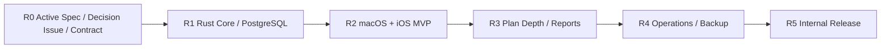

# KS-CORE Kshift 产品核心规范

> 结论：Kshift v1 是只在内网运行的 macOS/iOS 共享任务工作台。首版解决小团队共享任务、并发编辑和双平台一致性问题。

## 1. 适用范围

本 Spec 约束产品目标、用户、场景、首版范围、非目标和路线。

本 Spec 不定义任务字段、同步算法、运行安全、UI 材质或 Release 程序。领域规则见 [Active Spec 索引](index.md)。

本文使用三个规范词。

| 规范词 | 含义 |
| --- | --- |
| 必须 | 验收前必须满足 |
| 禁止 | 不得实施；需要例外时先修改 Spec |
| 可以 | 允许实施；不影响必需验收 |

## 2. 产品定义

Kshift 要解决小团队的任务协作问题。团队需要按项目、人员和自然日期查看同一组任务。

当前问题有三项。

1. 任务分散在表格、聊天和个人清单中。
2. 多人修改容易互相覆盖。
3. macOS 和 iOS 很难保持同一业务语义。

Kshift v1 的目标如下。

- 提供共享任务数据库。
- 提供多人并发编辑。
- 提供 macOS 和 iOS 的共享界面。
- 提供可备份、可恢复、可内网发布的运行方式。

Kshift 对齐 `wooduan-taskboard` 的可观察用户能力。Kshift 不复制参考产品的源码或技术栈。

## 3. 用户与场景

| 用户 | 主要目标 | 首版权限 |
| --- | --- | --- |
| Viewer | 查看计划、搜索任务和导出只读结果 | 只读 |
| Editor | 创建、编辑、移动和删除任务 | 项目读写 |
| Admin | 管理成员、数据库运维和备份恢复 | 全部管理权限 |

角色实施属于 R4。R2 可以先用受控测试身份。服务端必须保留最终鉴权边界。

### 3.1 P0 用户场景

| ID | 场景 | 结果 |
| --- | --- | --- |
| `SCN-001` | 用户切换到授权项目 | 只看到该项目数据 |
| `SCN-002` | 用户按人员和自然日期查看看板 | 任务出现在正确列 |
| `SCN-003` | 用户新建或编辑任务 | 服务端提交新 revision |
| `SCN-004` | 用户拖拽任务到其他人员或日期 | 任务和事件原子更新 |
| `SCN-005` | 两名用户编辑同一任务 | 过期写入被拒绝 |
| `SCN-006` | 用户按状态、优先级或负责人筛选 | 结果保持项目隔离 |
| `SCN-007` | 用户断网后继续查看内存快照 | 写入禁用并提示重连 |
| `SCN-008` | Admin 创建备份并恢复测试库 | 数据通过不变量检查 |

## 4. 范围与非目标

首版范围如下。

- macOS 和 iOS 客户端。
- Rust server 和 Rust client。
- PostgreSQL 18 共享数据库。
- 项目、成员、任务、状态、优先级、负责人和日期。
- 人员与日期看板、日历、表格和基础统计。
- 搜索、筛选、排序和批量处理。
- 多人并发编辑、冲突提示和 revision 同步。
- 子任务、依赖、甘特、历史、附件和报告。
- Viewer、Editor 和 Admin 角色。
- 受限数据库管理。
- 备份、恢复、服务和日志管理。
- GitHub 内网 Release。

以下内容状态为 `rejected`。

- Web 产品。
- Windows 客户端。
- Android 客户端。
- 外部平台导入。
- 公网部署。
- 离线写入和离线写队列。
- 客户端直接连接 PostgreSQL。
- SwiftUI UI 直接调用 HTTP。
- 平台各自复制产品页面和状态机。
- 自绘玻璃材质。
- 静默覆盖并发写入。
- 无界队列和无限重试。

新增平台或新增同步模型时，必须先建立 Research 或 Task Issue，并修改本 Spec。

## 5. 产品路线

每个阶段只在上游门禁通过后启动。

| 阶段 | 产品结果 | 退出条件 | Issue |
| --- | --- | --- | --- |
| R0 | 可评审的 Active Spec、Decision Issue 和合同 | Active Spec 和 Decision Issue 已建立 | [#3](https://github.com/wyz541/Kshift/issues/3) |
| R1 | 可运行的共享服务核心 | 并发、迁移和合同测试通过 | [#4](https://github.com/wyz541/Kshift/issues/4)、[#5](https://github.com/wyz541/Kshift/issues/5) |
| R2 | macOS/iOS 日计划 MVP | P0 E2E、复用和 Liquid Glass 门禁通过 | [#6](https://github.com/wyz541/Kshift/issues/6)、[#7](https://github.com/wyz541/Kshift/issues/7) |
| R3 | 计划深度与复盘 | 验收数据集通过 | [#8](https://github.com/wyz541/Kshift/issues/8) |
| R4 | 可运营的内网产品 | 权限、备份和恢复演练通过 | [#9](https://github.com/wyz541/Kshift/issues/9) |
| R5 | 可发布的内网产品 | 安装、升级、签名和回滚证据通过 | [#9](https://github.com/wyz541/Kshift/issues/9) |

## 6. 关联 Spec 和合同

| 领域 | Active Spec |
| --- | --- |
| 项目、成员、任务、日期和历史 | [KS-DOMAIN](domain.md) |
| 运行时边界、同步、缓存和数据库 | [KS-ARCH](architecture.md) |
| 安全、容量、备份和部署 | [KS-OPS](operations.md) |
| 平台、共享 UI、Liquid Glass 和无障碍 | [KS-UI](ui.md) |
| 质量门禁和 Release | [KS-RELEASE](release.md) |
| Issue、PR、标签和 Project | [KS-GOV](governance.md) |

本 Spec 不直接定义接口。产品范围约束 [Protocol Contract](../contracts/protocol-v0.1.md) 和 [Release Contract](../contracts/release-v0.1.md)。

## 7. 验收入口

- 产品目标、用户和场景：[Traceability](../spec/traceability.md)
- 正式评审：[R0 Spec Review](../reviews/2026-11-13-r0-spec-review.md)
- 总目标：[Issue #2](https://github.com/wyz541/Kshift/issues/2)
- 来源讨论：[Discussion #1](https://github.com/wyz541/Kshift/discussions/1)

## 8. 变更和回滚

产品范围变化必须建立 Research 或 Task Issue。本 Spec 的变化必须同步检查下游领域 Spec、合同和 Issue 入口。

回滚使用 Git 中上一版 Active Spec。回滚不删除历史决策证据。回滚不改变已写入的产品数据。
