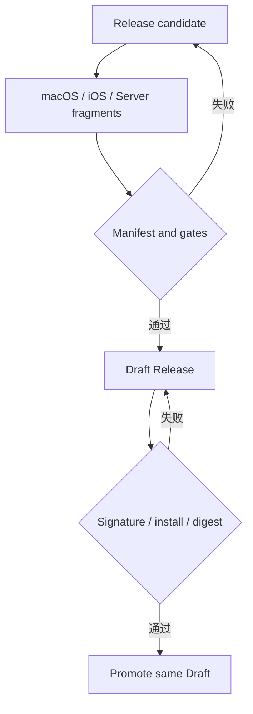

# KS-RELEASE Kshift 质量与发布规范

> 结论：一个版本只使用一个标签、一个 manifest 和一个 GitHub Release。平台 workflow 只构建和验证。单一 orchestrator 只提升已验证的同一个 Draft。

## 1. 适用范围

本 Spec 约束 Rust 质量门禁、Release JSON Schema、Release manifest、fragment、Draft、Promote、签名、provenance 和回滚。

UI 门禁见 [KS-UI](ui.md)。数据库和备份证据见 [KS-OPS](operations.md)。协议兼容规则见 [KS-ARCH](architecture.md)。

## 2. Rust 质量门禁

- `QA-RUST-001`：使用 `rust-toolchain.toml` 固定 toolchain。
- `QA-RUST-002`：提交并校验 `Cargo.lock`。
- `QA-RUST-003`：`cargo fmt --check` 通过。
- `QA-RUST-004`：`cargo clippy --all-targets --all-features -- -D warnings` 通过。
- `QA-RUST-005`：单元测试通过。
- `QA-RUST-006`：PostgreSQL 集成测试通过。
- `QA-RUST-007`：`buf lint` 通过。
- `QA-RUST-008`：buf breaking-change 检查通过。
- `QA-RUST-009`：`cargo deny check advisories bans licenses sources` 通过。
- `QA-RUST-010`：生成代码必须可重现。
- `QA-RUST-011`：Release 必须包含依赖 SBOM。

## 3. Release 合同

| 合同 | 文件 | 版本 |
| --- | --- | --- |
| Release manifest | [`release-manifest.schema.json`](../../schemas/release-manifest.schema.json) | `1` |
| Release fragment | [`release-fragment.schema.json`](../../schemas/release-fragment.schema.json) | `1` |

- `CTR-006`：JSON Schema 只允许兼容扩展。
- `CTR-007`：Release fixture 必须通过 schema 校验。

详细规则见 [Release Contract](../contracts/release-v0.1.md)。

## 4. 单一写入者和 Promote

下图展示单一写入者的发布流程。

- `REL-001`：一个版本只使用一个标签、一个 manifest 和一个 GitHub Release。
- `REL-002`：所有平台资产使用同一 source commit。
- `REL-003`：平台 workflow 只构建和验证，不写 Release。
- `REL-004`：只有一个 release orchestrator 可以写 Release。
- `REL-005`：Draft 验证通过后只提升同一个 Draft。
- `REL-006`：已发布标签和同名 Stable 资产禁止覆盖。
- `REL-007`：Stable 禁止包含 debug、ad-hoc 或 unsigned 资产。
- `REL-008`：Release manager 必须在受保护环境批准 Promote。
- `REL-009`：macOS 和 iOS 的最低系统版本必须写入 manifest 和 Release notes。
- `REL-010`：Release 必须包含 SHA-256、SBOM、provenance、attestation 和 gate 证据。

平台 workflow 使用 `contents: read`。平台 workflow 只上传 fragment。只有 release environment 中的 orchestrator 获得 `contents: write`。

## 5. 通道和回滚

| 通道 | 版本格式 | GitHub Release | Stable 资产 |
| --- | --- | --- | --- |
| Preview | `0.x.y-preview.n` | Prerelease | 不适用 |
| Stable | `x.y.z` | 正式 Release | 必须签名 |
| Hotfix | `x.y.z` | 正式 Release | 使用新 patch |

- Update feed 只读取 Stable Release。
- 已发布 Stable 的问题使用新 patch Release 修复。
- 已发布 Stable 的回滚使用新 patch Release。
- 回滚禁止移动已发布标签。
- 回滚禁止覆盖同名 Stable 资产。
- 失败 Draft 不提升。修复后重新准备 Draft。

## 6. Release 证据

Release 必须保留以下证据。

- Draft 和 Promote 的 workflow run ID。
- Manifest、fragment、checksums、SBOM 和 attestation。
- 平台构建日志和 gate 结果。
- macOS 安装、升级、卸载和回滚记录。
- iOS 安装和升级记录。
- Server 启动、健康、日志和恢复记录。
- PostgreSQL 版本、schema 和 migration digest。
- 备份和恢复演练记录。
- 并发、revision gap 和 2 倍负载结果。
- UI 复用、Liquid Glass、无障碍和性能记录。
- Release manager 的批准记录。

## 7. 验收入口

- Release 单元测试：`node --test release/test/release.test.mjs`
- Release 检查：`./scripts/check-r4-r5.sh`
- Schema 检查：`./scripts/check-r0.sh`
- 迁移来源：[ADR-0007](../adr/0007-github-release-orchestrator.md)

## 8. 变更和回滚

改变 Release 通道、manifest、fragment、Promote 或 Stable 回滚规则时，必须先建立 Research 或 Task Issue。

回滚使用 Git 中上一版 Active Spec。已发布 Release 的修复使用新 patch Release。禁止回退标签或覆盖资产。
