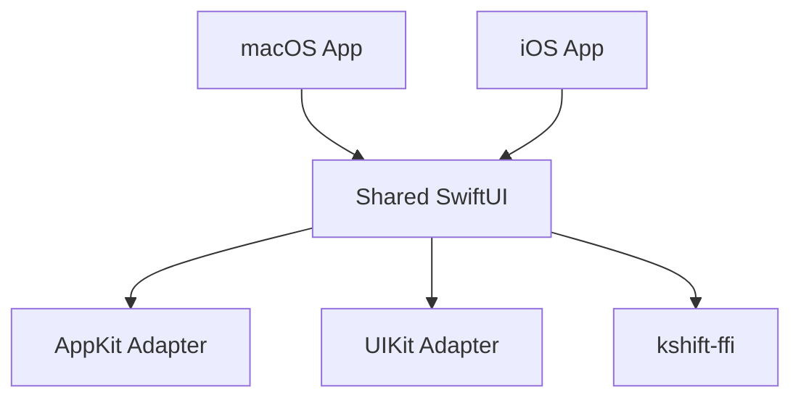

# KS-UI Kshift 界面与无障碍规范

> 结论：macOS 和 iOS 共享一套 SwiftUI。Windows 使用 Rust 和 gpui。平台差异只进入 adapter。默认规划视图是人员排期。`KshiftRootView` 是 macOS 和 iOS 的唯一日计划 UI。

## 1. 适用范围

本 Spec 约束平台范围、共享 UI、平台 adapter、Liquid Glass、无障碍、性能、唯一日计划入口和 UI 验收门禁。

任务语义见 [KS-DOMAIN](domain.md)。FFI 边界见 [KS-ARCH](architecture.md)。

## 2. 平台矩阵

| 项目 | 决策 |
| --- | --- |
| 最低系统 | macOS 26.0、iOS 26.0、Windows 11（x86_64） |
| 共享 UI | macOS 和 iOS 共享 SwiftUI feature slices、components、styles、presentation mapping |
| macOS 适配 | AppKit adapter |
| iOS 适配 | UIKit adapter；只处理系统集成 |
| Windows UI | Rust + gpui。独立视图层。不复用 SwiftUI 类型。 |
| Windows 适配 | DPI、字体、键盘、窗口 chrome 和文件对话框 |
| 业务状态 | Rust client 提供的 immutable snapshot 或 event |
| 视觉核心 | macOS 和 iOS 使用 Apple 原生 Liquid Glass。Windows 使用高对比内容底板。 |

客户端平台为 macOS、iOS 和 Windows。Web、Android 和外部导入不进入首版。Windows 首版只进入 Preview 通道。

## 2.1 Windows parity 边界

Windows 与 macOS 对齐的范围如下。

- `UI-WIN-001`：Windows 必须对齐 macOS 的信息架构、布局层级、状态色、优先级色和交互结果。
- `UI-WIN-002`：Windows 禁止自绘 Liquid Glass，也禁止用渐变或模糊模拟玻璃。内容区使用纯色高对比底板。
- `UI-WIN-003`：Windows 和 macOS 必须使用同一任务语义和同一 FFI JSON 投影。禁止在 Windows 复制业务校验。
- `UI-WIN-004`：允许的差异只包括窗口 chrome、菜单、文件对话框、DPI 缩放和字体回退。
- `UI-WIN-005`：Windows 验收必须包含 1280×800 布局和 150% 缩放截图。未运行项必须标明未运行。

## 3. 共享 SwiftUI 与平台边界

下图展示共享 UI 与平台 adapter 的边界。

- `UI-REU-001`：macOS 和 iOS 的 P0 页面必须来自同一 SwiftUI 实现。
- `UI-REU-002`：页面、状态机、校验、数据映射和导航不得复制到平台 target。
- `UI-REU-003`：AppKit 只处理 macOS 特有能力，例如窗口、菜单、键盘命令、拖放和系统面板。
- `UI-REU-004`：UIKit 只包装 UIKit-only controller 或 iOS 特有能力。
- `UI-REU-005`：SwiftUI 或系统组件已覆盖需求时，禁止新增 AppKit 或 UIKit 实现。
- `UI-REU-006`：`#if os(...)` 只允许出现在 app entry、capability adapter 和 platform style resolver。
- `UI-REU-007`：两端可以自适应窗口尺寸。行为、验收语义和业务状态必须一致。

## 4. 唯一日计划 UI

- macOS 和 iOS app 只组合 `KshiftRootView`。
- `AppModel` 是 `KshiftRootView` 的共享状态模型。
- 禁止恢复 `KshiftDayPlanFeatureView` 或其专用模型、组件、映射和测试。
- `KshiftPresentation` 的平台 capability 类型保持可用。
- `KshiftFFI` 的 Rust C ABI wrapper 保持可用。
- 原型源码只从 Git 提交 `84a8d1d` 追溯。
- 后续需要拆分 `KshiftRootView` 时，创建内部 feature slice。禁止恢复第二套 app 入口。
- `UI-EDIT-001`：Click a schedule task bar, board task card or compact task row, or a table task title to open an anchored quick-edit Popover. Task-card and table-row edit menu actions use the same Popover. Quick edit does not set root `editorDraft` or open the task-detail Sheet. Use the explicit details menu action to open the full task-detail Sheet. New-task Popover behavior is unchanged. The Popover places status, priority, assignee, and dates before the Markdown description. Keep Cancel and Save in the fixed footer without a task-version label.

## 4.1 R3 计划深度 UI

- `UI-R3-001`：PlannerView 必须在 view mode 不是 PeopleSchedule 时提供 visible Plan Depth entry。PeopleSchedule 不得显示 legacy Plan Depth entry。
- `UI-R3-002`：macOS 和 iOS 必须使用同一个 `KshiftPlanDepthFeatureView`。
- `UI-R3-003`：看板任务卡必须使用 Apple 原生 Liquid Glass。
- `UI-R3-004`：甘特、历史和报告必须使用稳定内容底板。
- `UI-R3-005`：报告打印和图片导出不得重新读取 live project state。
- `UI-R3-006`：R3 页面必须通过对比度、动态字号、触控区域、文字裁切和元素描述审计。
- `UI-R3-007`：Plan Depth sheet 必须提供 explicit Close action，accessibility identifier 为 `close-plan-depth`。Regular horizontal-size presentation 必须有 `860pt` minimum width 和 `700pt` minimum height。
- `UI-R3-008`：甘特任务行必须同时表达原始计划、当前目标和延期。连续延长时保留原计划段，使用独立延期段覆盖新增日期，并在原截止日绘制 marker。延期任务必须显示 `延期 N 天` 徽标。
- `UI-R3-009`：同一行连续延长不得绘制冗余长连线。只有前后区间不连续或存在多次改期时才绘制改期轨迹。改期轨迹必须使用虚线或独立 marker，并带有日期/延期文案；不得复用普通任务依赖的跨行正交箭头。
- `UI-R3-010`：甘特任务详情必须显示原始计划、当前计划、累计延期、是否逾期后改期、最近一次原因、操作者和改期时间。多次改期必须可查看每次增量。
- `UI-R3-011`：延期状态不得只依赖颜色或纹理。任务行和详情的 accessibility label 必须包含原计划、当前目标、延期天数和改期原因；普通依赖必须继续读作任务依赖。
- `UI-R3-012`：可编辑的 Plan Depth task 必须提供改期 entry。Date picker 必须拒绝 `starts_on > due_on`；保存时必须提交 reason、task version 和 project revision，并展示冲突错误。

## 5. Liquid Glass 边界

“应用尽用”按交互语义执行。

| 场景 | 必须使用 | 禁止行为 |
| --- | --- | --- |
| 窗口、侧栏、导航、标签栏、工具栏 | SwiftUI 系统组件 | 自绘替代系统材质 |
| Sheet、Popover、菜单 | 系统原生 Liquid Glass | 固定透明度和高光仿制 |
| 主要操作按钮 | `.buttonStyle(.glassProminent)` | 自绘模糊背景 |
| 次要操作和浮动操作 | `.buttonStyle(.glass)` 或原生 `.glassEffect(...)` | 每控件单独创建容器 |
| 看板中可拖拽、可选择、可执行命令的任务卡片 | `Glass.regular` 外表面 | 玻璃直接承载低对比文字 |
| 人员排期任务条 | SwiftUI `Button` + `.glassEffect(.regular.tint(...).interactive(), in: Capsule(style: .continuous))` 和明亮优先级徽章 | `.buttonStyle(.glass)` 作为最终任务条、自绘玻璃、渐变、模糊和阴影 |
| 人员排期工具栏按钮 | `KshiftCompactGlassButtonStyle`、neutral glass 和 primary content | accent-tinted `.buttonStyle(.glass)`、过高的玻璃容器 |
| 窗口 primaryAction toolbar | secondary actions 使用 `KshiftCompactGlassButtonStyle`；最多一个 primary action 使用 `KshiftCompactAccentGlassButtonStyle` | 多个 `.glassProminent` actions、deep accent-tinted clusters |
| 同组相邻玻璃卡片 | 共用一个 `GlassEffectContainer` | 每卡片一个 container |
| 纯展示卡片 | 标准材质或清晰内容底板 | 用玻璃作为唯一可读表面 |
| 正文、密集表格、人员排期、长文本编辑 | 清晰内容底板 | 低对比玻璃正文 |
| AppKit 专属区域 | `NSGlassEffectView` 和 SwiftUI wrapper | 另写一套 AppKit 产品 UI |

- `UI-GLS-001`：只使用 Apple 原生材质和 API。
- `UI-GLS-002`：禁止自绘模糊、折射、噪点、渐变或高光来模拟玻璃。
- `UI-GLS-003`：看板交互卡片使用 `Glass.regular`。人员排期任务条使用 SwiftUI 原生 `.glassEffect(.regular.tint(...).interactive(), in: Capsule(style: .continuous))`。禁止把 `.buttonStyle(.glass)` 用作最终任务条。禁止自绘玻璃效果。文字和控件必须保持稳定对比度。
- `UI-GLS-004`：纯展示和密集内容默认使用标准材质。玻璃可以只作为外层容器。
- `UI-GLS-005`：同屏玻璃 effect 和 container 必须有性能上限。
- `UI-GLS-006`：超过实测预算时，优先保留导航和当前操作卡片。
- `UI-GLS-007`：使用系统语义色和 tint。禁止用玻璃透明度承载状态含义。
- `UI-GLS-008`：Window primaryAction toolbar 必须使用 one-level hierarchy。Secondary actions 使用 neutral `KshiftCompactGlassButtonStyle`。At most one primary action 使用 `KshiftCompactAccentGlassButtonStyle`。Visual height 必须为 34pt。Outer hit target 不得小于 44pt。Accent glass opacity 不得高于 `0.18` in Light Mode and `0.30` in Dark Mode。禁止 multiple `.glassProminent` actions。

## 6. 无障碍与性能

- `UI-A11Y-001`：必须支持 Reduce Transparency。
- `UI-A11Y-002`：必须支持 Increase Contrast。
- `UI-A11Y-003`：必须支持 Reduce Motion。
- `UI-A11Y-004`：必须支持 Dark Mode 和系统文字大小。
- `UI-A11Y-005`：无障碍验收必须使用可重复的自动 UI 测试。
- `UI-A11Y-006`：iOS 必须通过自动无障碍审计、触控目标和动态文字测试。
- `UI-PERF-001`：iOS 滚动、拖拽和 Sheet 切换必须有 XCUITest 性能读数。
- `UI-PERF-002`：性能读数必须记录设备、系统、测试名称和指标。

## 7. UI 门禁

- `QA-UI-001`：两端 P0 页面来自同一 shared SwiftUI 实现。
- `QA-UI-002`：两端 P0 行为和验收语义一致。
- `QA-UI-003`：AppKit 和 UIKit 只出现在 adapter 或系统集成边界。
- `QA-UI-004`：Liquid Glass 使用符合本 Spec 第 5 节。
- `QA-UI-005`：Reduce Transparency、Increase Contrast 和 Reduce Motion 检查通过。
- `QA-UI-006`：自动无障碍审计、触控目标和系统文字大小测试通过。
- `QA-UI-007`：iOS 滚动、拖拽和 Sheet 切换有 XCUITest 性能读数。
- `QA-UI-008`：Windows Preview 必须通过 `UI-WIN-001` 至 `UI-WIN-005`。Windows 不得进入 Stable，直到 Release 门禁和签名决策完成。

## 7.1 人员排期工作区

- `UI-PPL-001`：`PlannerViewMode` 必须包含人员排期。视图切换器和侧栏必须把人员排期放在首位。
- `UI-PPL-002`：macOS 和 iOS 必须使用同一个 `PeopleScheduleView`。禁止复制平台页面。
- `UI-PPL-003`：人员行必须显示头像、姓名、角色、任务数、进行中数量、P0 数量和折叠按钮。
- `UI-PPL-004`：人员列默认宽度为 `196pt`。日期列宽度必须限制在 `96pt` 至 `360pt`。
- `UI-PPL-005`：密度必须包含紧凑、标准和宽松。默认密度为紧凑。
- `UI-PPL-006`：任务条必须使用 SwiftUI `Button`、`.buttonStyle(.plain)` 和原生 `.glassEffect(.regular.tint(...).interactive(), in: Capsule(style: .continuous))`。Light Mode 的 tint opacity 必须为 `0.28`。Dark Mode 的 tint opacity 必须为 `0.45`。任务条使用 36pt 视觉高度和单行标题。日期 slice 的水平 inset 必须为 8pt。标题宽度必须按任务条剩余宽度计算，使用 tail truncation，并 clip 到胶囊边界。紧凑、标准和宽松密度的任务行间距分别为 40pt、48pt 和 56pt。禁止把 `.buttonStyle(.glass)` 用作最终任务条。禁止纯黑背景、自绘玻璃、渐变、模糊和阴影。P0 徽章使用 `#D92D3A`，P1 徽章使用 `#FFC400`，P2 徽章使用 `#0066FF`，P3 徽章使用 `#5F6368`。结构和标题必须保持 WCAG AA 对比度。
- `UI-PPL-007`：已完成任务使用完成状态图标表达。禁止降低整条任务条的文本对比度。状态控件使用原生菜单显示状态文字和图标。悬停不得自动打开状态菜单。
- `UI-PPL-008`：任务泳道必须避免重叠。任务排序先使用优先级，再使用状态权重。
- `UI-PPL-009`：横向裁切任务必须把标题吸附到视口可见边缘。完整可见任务必须把标题放回任务起点。
- `UI-PPL-010`：每条泳道最多显示一个路标。路标不得覆盖可见任务。跨周期定位必须先切换周期。
- `UI-PPL-011`：常规时间轴中的任务可以拖到其他人员或其他日期。任务边缘可以调整开始日期或截止日期。紧凑列表中的任务可以拖到其他人员分组；日期通过任务编辑器修改。
- `UI-PPL-012`：人员排期必须支持标题、说明和标签搜索，以及负责人、状态、优先级和标签筛选。
- `UI-PPL-013`：项目偏好必须保存当前日期、横向位置、人员列宽度、日期列宽度、显示密度、折叠状态和视图选择。
- `UI-PPL-014`：人员排期必须提供网格语义、图标按钮标签、键盘焦点、悬停预览和 Reduce Motion 行为。
- `UI-PPL-015`：`compact` 水平尺寸类必须使用按人员分组的纵向任务列表。任务条必须使用 UI-PPL-006 的全宽原生染色玻璃、`Capsule(style: .continuous)` 和单行标题。常规水平尺寸类继续使用人员×日期时间轴。
- `UI-PPL-016`：人员排期模式不得显示重复的 `SummaryStrip`。Regular horizontal-size class 的任务数量显示在排期工具栏。Compact horizontal-size class 的任务数量显示在排期内容区顶部，只统计当前周期内的任务。人员分组标题显示各自的任务数量。
- `UI-PPL-017`：任务状态徽章必须使用 26pt 外框、3pt 状态语义色环、白色中性内盘和 `13pt` heavy 状态符号。`todo` 使用 `circle.dashed` 和 `#8E8E93`/`#4B4B50`。`inProgress` 使用 `clock.fill` 和 `#0A84FF`/`#0057C8`。`blocked` 使用 `exclamationmark.octagon.fill` 和 `#FF453A`/`#A61B1B`。`done` 使用 `checkmark` 和 `#30D158`/`#0F7A3D`。优先级继续由 task bar tint 表达。状态菜单保持 44pt 触控区域。
- `UI-PPL-018`：Planner toolbar 和 PeopleSchedule toolbar 的 action buttons 必须使用 `KshiftCompactGlassButtonStyle`。Visual height 必须为 34pt。Outer hit target 不得小于 44pt。Content 必须使用 primary color。Glass 必须使用 neutral `.glassEffect(.regular.interactive())`。禁止 accent-tinted `.buttonStyle(.glass)` 和 oversized glass container。Schedule toolbar 的 vertical padding 必须为 4pt，minimum height 必须为 52pt。
- `UI-PPL-019`：macOS work area 必须将 vertical wheel route 到 nearest vertical scroll view。Shift + wheel 必须 route 到 nearest horizontal scroll view。Wheel routing 必须保留 precise scrolling deltas。Event handling 必须位于 `KshiftAppKitAdapter`。
- `UI-PPL-020`：Click blank schedule day cell 必须使用 clicked person 和 clicked date 创建 local `TaskDraft`。交互必须打开 `TaskEditorView` 的 `popover` presentation。Popover default size 必须为 560pt × 580pt。Popup layout 必须使用 responsive assignee row 和 two-date row。该交互不得设置 root `editorDraft` 或复用 sheet presentation。
- `UI-PPL-021`：Regular horizontal-size PeopleSchedule 必须隐藏 PlannerView 的 global date navigation row。Schedule toolbar 必须是唯一 date 和 period navigation source。Schedule toolbar 必须包含 date picker、period control、density、sort、filter 和 settings。The filter action 必须打开 `FilterPopover`，不得复用 clear-selection behavior。Compact horizontal-size class 必须保留 view picker，并只使用一条 schedule toolbar row：上一周期、今天、下一周期、sort、filter 和 overflow menu。Overflow menu 必须包含 period、refresh 和 layout settings。Compact PeopleSchedule 不得显示 PlannerView compact action bar，并不得显示 duplicate filter action。
- `UI-PPL-022`：Sidebar footer 的 trailing action 必须是 settings gear button。该按钮必须打开 `KshiftAppSettingsView`。Settings surface 必须包含 schedule layout controls、system accessibility shortcut 和 about information。禁止将 system accessibility settings 作为 footer button 的直接 action。Button accessibility identifier 必须为 `settings-button`。
- `UI-PPL-023`：Task bar 必须在 pointer hover 450ms 后显示 adjacent preview panel。Preview panel 必须显示 title、status、priority、assignee、date、tags 和 rendered Markdown detail。Preview panel 必须是 read-only，并使用 accessibility identifier `task-preview-<task-id>`。
- `UI-PPL-024`：Task detail 和 task editor 必须使用 shared Markdown workspace，并通过 `源码` / `预览` mode switch 切换显示。Existing task detail 必须打开 editable `TaskEditorView` sheet。New task 默认使用 `源码` mode。Existing task with content 默认使用 `预览` mode。Preview 必须支持 heading、paragraph、bullet list、numbered list、blockquote、divider 和 fenced code block。Inline Markdown 必须保留。`详情` mode 必须提供 large editing surface。
- `UI-PPL-025`：Regular task detail 和 task editor sheet 必须为 `800pt × 720pt`。Titlebar 必须使用 classic macOS window structure：`52pt` system-material bar、centered `13pt` semibold `修改任务` or `新建任务` title、leading red traffic-light close control、draggable chrome surface、trailing neutral small `简约` / `详情` segmented control and bottom separator。Close control 必须使用 `28pt` macOS hit target，并只在 hover 时显示 xmark glyph。`简约` mode 必须显示 task name、Markdown workspace、equal-width priority/status strips、assignee/start/due/duration fields and tag editor。`详情` mode 必须聚焦 Markdown workspace。Schedule task editor popover width 保持 `560pt`。
- `UI-PPL-026`：Toolbar、planner floating action、board column action、calendar action and macOS menu 的 new-task action 必须打开 `TaskEditorView` popover。禁止 new-task action 使用 sheet。Popover 必须 anchor 到 initiating control；menu shortcut 可以 anchor 到 toolbar New Task button。Existing-task quick edit from a schedule task bar, board task card, or table task row must follow `UI-EDIT-001`。Task-detail sheet 保持完整编辑 surface。
- `UI-PPL-027`：Sidebar 的 project selection 和 planning-view selection 必须使用 typed selection。Click planning-view row 不得写入 `selectedProjectID`。`selectProject` 必须 reject identifiers that are absent from the loaded project list。
- `UI-PPL-028`：Task detail panel 必须使用 single translucent material backdrop 和 group-level native Liquid Glass surfaces。Task-name、description、priority/status、schedule metadata and tags must group into a small number of `GlassEffectContainer` surfaces。Controls inside these surfaces must use flat fills。Title field、Markdown formatting toolbar、priority/status strips、schedule metadata controls and titlebar segmented control 不得再次应用 `.glassEffect`。禁止为每个 field 单独叠加 glass effect。Footer 必须固定在 panel bottom 并使用 translucent material。
- `UI-PPL-029`：PeopleSchedule person header 不得使用 overlay 绘制 task metrics。Name 与 disclosure 必须位于首行；role 与 metrics 必须位于次行。Name 和 role 必须在 metrics 之前 tail truncate。Expanded header 必须显示 task count；in-progress 和 P0 metrics 只在 count 大于 0 时显示。Header 在 `168pt` 最小人员列宽下不得发生 text 与 metric overlap。
- `UI-PPL-030`：macOS Window toolbar 的 primary actions 不得添加局部 `.glassEffect`。系统 toolbar group 必须提供唯一 Liquid Glass surface。Filter、refresh 和 audit 必须使用原生 borderless toolbar buttons。New Task 必须使用 accent tint 和原生 button interaction。禁止 double glass、double border 和 custom 44pt toolbar hit frame。
- `UI-PPL-031`：Schedule sort menu 不得使用 nested `Picker` submenu。`手动顺序`、`优先级`、`标题` 和 `最近更新` 必须直接显示在 first-level menu。Current option 必须显示 native checkmark。Option selection 必须立即 update `sortOption`，不得保留 redundant `排序` parent item。
- `UI-PPL-032`：Existing task detail footer 必须显示 `历史`、`复制`、`删除`、`取消` 和 `保存`。History button 必须打开 task-history popover。Copy 必须 create a duplicated task through `saveTask`。Delete 必须 use the shared project deletion confirmation。Save 必须 preserve expected task version。
- `UI-PPL-033`：Task detail mode switching must use a short snappy transition，and must respect Reduce Motion。The close action must use native macOS traffic-light interaction。Accent tint must be restrained to selected controls, primary Save action and low-opacity ambient context。
- `UI-PPL-034`：Task detail titlebar 不得使用 oversized leading title block or `NavigationStack` toolbar that renders actions outside the titlebar。Title 必须在 bar 中居中。Close action 必须位于 leading edge，并必须呈现为 native macOS red traffic-light control。Control frame 必须为 `28pt` macOS target；12pt red disc 必须使用 hover-only xmark。Titlebar blank surface 必须提供 window-drag interaction。Mode control 必须位于 trailing edge，使用 neutral-tinted small segmented control。Titlebar 必须使用 `52pt` system bar material and a `0.5pt` separator。
- `UI-PPL-035`：`FilterPopover` 必须使用 `300pt × 580pt` 固定尺寸、fixed header and footer。Filter content 必须使用 compact multi-select chips，不得恢复 vertical switch rows。Assignee chips 必须使用 adaptive two-column grid。Status 和 priority chips 必须分别使用 four-column grids。Tags 必须使用 adaptive grid。Sort options 必须使用 two-column grid。Selected chips 必须使用 tint、outline、`selected` accessibility state and `已选择` accessibility value。Wide selected chips 必须同时显示 checkmark。Selected compact chips 必须保持 primary text contrast；禁止把 bright P1 yellow or neutral todo tint 用作 white-text solid fill。Header 必须显示 active-condition count and enabled reset action。Footer 必须显示 filtered-task count and prominent `完成` action。Popover 在右侧 toolbar anchor 下不得发生 clipping、overlap or dead space。
- `UI-PPL-036`：Compact PeopleSchedule 必须隐藏 duplicated global day-navigation row，并只保留一个 schedule navigation row。Accessibility text sizes 必须把 compact person role and metrics reflow below the name。Person header 必须保持在 window bounds 内，不得发生 horizontal clipping。
- `UI-PPL-037`：Compact PeopleSchedule 必须在 schedule toolbar 下方显示固定的 week strip。Week strip 只列出有任务的周，并始终包含本周和所选周。每个 week chip 显示日期范围和任务数量；跨周任务在每个重叠的周计数。Tap week chip 必须切换到 week period 并显示该周。Week chip 文字必须使用 strong text color，selection 使用 tint 和 accent border，并支持 Dynamic Type。Compact task bar 必须显示完整日期范围。
- `UI-PPL-038`：Compact `NavigationStack` 不承载 toolbar items 时，必须使用 `.toolbarVisibility(.hidden, for: .automatic)` 隐藏空 navigation bar。Project title 必须直接位于 status bar 下方。System search 必须保留在 bottom toolbar 并保持可用。

## 8. 关联合同

UI host 只消费 `kshift-ffi` 的 opaque handle、typed command、bounded snapshot/event 和稳定错误。

- [Protocol Contract](../contracts/protocol-v0.1.md)
- [`kshift.proto`](../../proto/kshift/v1/kshift.proto)

## 9. 验收入口

- 平台边界：`./scripts/check-platform-boundaries.sh`
- Swift 测试：`swift test`
- 人员排期单元测试：`swift test --filter PeopleScheduleTests`
- 人员排期证据：[People Schedule Evidence](../evidence/people-schedule/README.md)
- macOS/iOS live P0 E2E：`make live-ui-e2e`
- 无障碍证据：[Accessibility Evidence](../evidence/accessibility/README.md)
- 迁移来源：[ADR-0002](../adr/0002-macos-ios-first.md)、[ADR-0003](../adr/0003-native-liquid-glass-boundary.md)、[ADR-0009](../adr/0009-single-day-plan-ui.md)

## 10. 变更和回滚

改变平台范围、共享 UI 入口、Liquid Glass 边界或无障碍门禁时，必须先建立 Research 或 Task Issue。

回滚使用 Git 中上一版 Active Spec。回滚不得恢复第二套 app 入口，也不得静默降低无障碍门禁。
