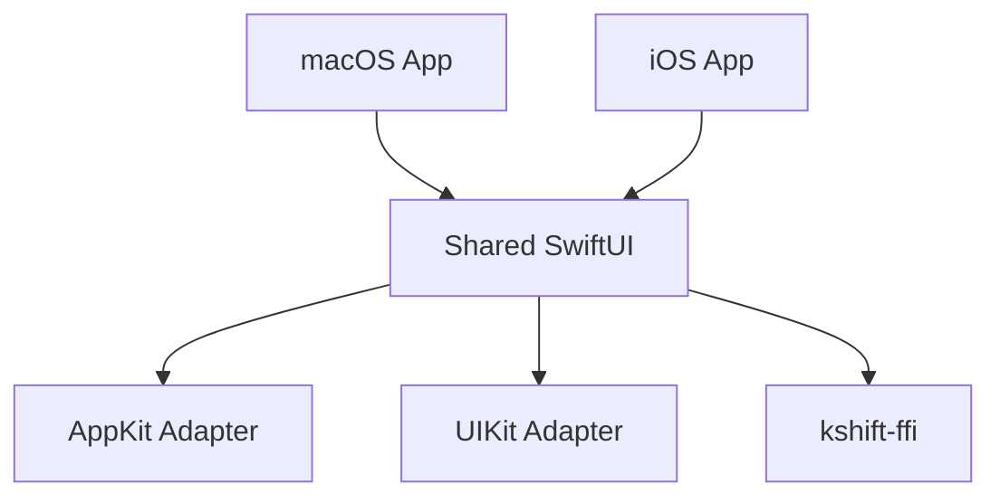

# KS-UI Kshift 界面与无障碍规范

> 结论：macOS 和 iOS 共享一套 SwiftUI。平台差异只进入 adapter。默认规划视图是人员排期。`KshiftRootView` 是唯一日计划 UI。

## 1. 适用范围

本 Spec 约束平台范围、共享 UI、平台 adapter、Liquid Glass、无障碍、性能、唯一日计划入口和 UI 验收门禁。

任务语义见 [KS-DOMAIN](domain.md)。FFI 边界见 [KS-ARCH](architecture.md)。

## 2. 平台矩阵

| 项目 | 决策 |
| --- | --- |
| 最低系统 | macOS 26.0、iOS 26.0 |
| 共享 UI | SwiftUI feature slices、components、styles、presentation mapping |
| macOS 适配 | AppKit adapter |
| iOS 适配 | UIKit adapter；只处理系统集成 |
| 业务状态 | Rust client 提供的 immutable snapshot 或 event |
| 视觉核心 | Apple 原生 Liquid Glass |

首版平台只有 macOS 和 iOS。Web、Windows、Android 和外部导入不进入首版。

## 3. 共享 SwiftUI 与平台边界

下图展示共享 UI 与平台 adapter 的边界。

- `UI-REU-001`：macOS 和 iOS 的 P0 页面必须来自同一 SwiftUI 实现。
- `UI-REU-002`：页面、状态机、校验、数据映射和导航不得复制到平台 target。
- `UI-REU-003`：AppKit 只处理 macOS 特有能力，例如窗口、菜单、键盘命令、拖放和系统面板。
- `UI-REU-004`：UIKit 只包装 UIKit-only controller 或 iOS 特有能力。
- `UI-REU-005`：SwiftUI 或系统组件已覆盖需求时，禁止新增 AppKit 或 UIKit 实现。
- `UI-REU-006`：`#if os(...)` 只允许出现在 app entry、capability adapter 和 platform style resolver。
- `UI-REU-007`：两端可以自适应窗口尺寸。行为、验收语义和业务状态必须一致。

## 4. 唯一日计划 UI

- macOS 和 iOS app 只组合 `KshiftRootView`。
- `AppModel` 是 `KshiftRootView` 的共享状态模型。
- 禁止恢复 `KshiftDayPlanFeatureView` 或其专用模型、组件、映射和测试。
- `KshiftPresentation` 的平台 capability 类型保持可用。
- `KshiftFFI` 的 Rust C ABI wrapper 保持可用。
- 原型源码只从 Git 提交 `84a8d1d` 追溯。
- 后续需要拆分 `KshiftRootView` 时，创建内部 feature slice。禁止恢复第二套 app 入口。

## 4.1 R3 计划深度 UI

- `UI-R3-001`：`KshiftRootView` 必须提供可见的计划深度入口。
- `UI-R3-002`：macOS 和 iOS 必须使用同一个 `KshiftPlanDepthFeatureView`。
- `UI-R3-003`：看板任务卡必须使用 Apple 原生 Liquid Glass。
- `UI-R3-004`：甘特、历史和报告必须使用稳定内容底板。
- `UI-R3-005`：报告打印和图片导出不得重新读取 live project state。
- `UI-R3-006`：R3 页面必须通过对比度、动态字号、触控区域、文字裁切和元素描述审计。

## 5. Liquid Glass 边界

“应用尽用”按交互语义执行。

| 场景 | 必须使用 | 禁止行为 |
| --- | --- | --- |
| 窗口、侧栏、导航、标签栏、工具栏 | SwiftUI 系统组件 | 自绘替代系统材质 |
| Sheet、Popover、菜单 | 系统原生 Liquid Glass | 固定透明度和高光仿制 |
| 主要操作按钮 | `.buttonStyle(.glassProminent)` | 自绘模糊背景 |
| 次要操作和浮动操作 | `.buttonStyle(.glass)` 或原生 `.glassEffect(...)` | 每控件单独创建容器 |
| 可拖拽、可选择、可执行命令的任务卡片 | `Glass.regular` 外表面 | 玻璃直接承载低对比文字 |
| 同组相邻玻璃卡片 | 共用一个 `GlassEffectContainer` | 每卡片一个 container |
| 纯展示卡片 | 标准材质或清晰内容底板 | 用玻璃作为唯一可读表面 |
| 正文、密集表格、人员排期、长文本编辑 | 清晰内容底板 | 低对比玻璃正文 |
| AppKit 专属区域 | `NSGlassEffectView` 和 SwiftUI wrapper | 另写一套 AppKit 产品 UI |

- `UI-GLS-001`：只使用 Apple 原生材质和 API。
- `UI-GLS-002`：禁止自绘模糊、折射、噪点、渐变或高光来模拟玻璃。
- `UI-GLS-003`：交互卡片使用 `Glass.regular`。文字和控件必须位于对比稳定的内容底板。
- `UI-GLS-004`：纯展示和密集内容默认使用标准材质。玻璃可以只作为外层容器。
- `UI-GLS-005`：同屏玻璃 effect 和 container 必须有性能上限。
- `UI-GLS-006`：超过实测预算时，优先保留导航和当前操作卡片。
- `UI-GLS-007`：使用系统语义色和 tint。禁止用玻璃透明度承载状态含义。

## 6. 无障碍与性能

- `UI-A11Y-001`：必须支持 Reduce Transparency。
- `UI-A11Y-002`：必须支持 Increase Contrast。
- `UI-A11Y-003`：必须支持 Reduce Motion。
- `UI-A11Y-004`：必须支持 Dark Mode 和系统文字大小。
- `UI-A11Y-005`：无障碍验收必须使用可重复的自动 UI 测试。
- `UI-A11Y-006`：iOS 必须通过自动无障碍审计、触控目标和动态文字测试。
- `UI-PERF-001`：iOS 滚动、拖拽和 Sheet 切换必须有 XCUITest 性能读数。
- `UI-PERF-002`：性能读数必须记录设备、系统、测试名称和指标。

## 7. UI 门禁

- `QA-UI-001`：两端 P0 页面来自同一 shared SwiftUI 实现。
- `QA-UI-002`：两端 P0 行为和验收语义一致。
- `QA-UI-003`：AppKit 和 UIKit 只出现在 adapter 或系统集成边界。
- `QA-UI-004`：Liquid Glass 使用符合本 Spec 第 5 节。
- `QA-UI-005`：Reduce Transparency、Increase Contrast 和 Reduce Motion 检查通过。
- `QA-UI-006`：自动无障碍审计、触控目标和系统文字大小测试通过。
- `QA-UI-007`：iOS 滚动、拖拽和 Sheet 切换有 XCUITest 性能读数。

## 7.1 人员排期工作区

- `UI-PPL-001`：`PlannerViewMode` 必须包含人员排期。视图切换器和侧栏必须把人员排期放在首位。
- `UI-PPL-002`：macOS 和 iOS 必须使用同一个 `PeopleScheduleView`。禁止复制平台页面。
- `UI-PPL-003`：人员行必须显示头像、姓名、角色、任务数、进行中数量、P0 数量和折叠按钮。
- `UI-PPL-004`：人员列默认宽度为 `196pt`。日期列宽度必须限制在 `96pt` 至 `360pt`。
- `UI-PPL-005`：密度必须包含紧凑、标准和宽松。默认密度为紧凑。
- `UI-PPL-006`：任务条只显示状态图标和标题。任务条使用 `Glass.regular.interactive()` 外表面。优先级使用系统色 tint 和 3pt 语义色指示条。禁止使用不透明纯色背景承载文字。
- `UI-PPL-007`：已完成任务必须降低透明度。状态按钮必须支持悬停或点击展开。
- `UI-PPL-008`：任务泳道必须避免重叠。任务排序先使用优先级，再使用状态权重。
- `UI-PPL-009`：横向裁切任务必须把标题吸附到视口可见边缘。完整可见任务必须把标题放回任务起点。
- `UI-PPL-010`：每条泳道最多显示一个路标。路标不得覆盖可见任务。跨周期定位必须先切换周期。
- `UI-PPL-011`：任务可以拖到其他人员或其他日期。任务边缘可以调整开始日期或截止日期。
- `UI-PPL-012`：人员排期必须支持标题、说明和标签搜索，以及负责人、状态、优先级和标签筛选。
- `UI-PPL-013`：项目偏好必须保存当前日期、横向位置、人员列宽度、日期列宽度、显示密度、折叠状态和视图选择。
- `UI-PPL-014`：人员排期必须提供网格语义、图标按钮标签、键盘焦点、悬停预览和 Reduce Motion 行为。

## 8. 关联合同

UI host 只消费 `kshift-ffi` 的 opaque handle、typed command、bounded snapshot/event 和稳定错误。

- [Protocol Contract](../contracts/protocol-v0.1.md)
- [`kshift.proto`](../../proto/kshift/v1/kshift.proto)

## 9. 验收入口

- 平台边界：`./scripts/check-platform-boundaries.sh`
- Swift 测试：`swift test`
- 人员排期单元测试：`swift test --filter PeopleScheduleTests`
- 人员排期证据：[People Schedule Evidence](../evidence/people-schedule/README.md)
- macOS/iOS live P0 E2E：`make live-ui-e2e`
- 无障碍证据：[Accessibility Evidence](../evidence/accessibility/README.md)
- 迁移来源：[ADR-0002](../adr/0002-macos-ios-first.md)、[ADR-0003](../adr/0003-native-liquid-glass-boundary.md)、[ADR-0009](../adr/0009-single-day-plan-ui.md)

## 10. 变更和回滚

改变平台范围、共享 UI 入口、Liquid Glass 边界或无障碍门禁时，必须先建立 Research 或 Task Issue。

回滚使用 Git 中上一版 Active Spec。回滚不得恢复第二套 app 入口，也不得静默降低无障碍门禁。
